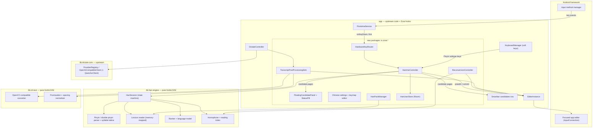
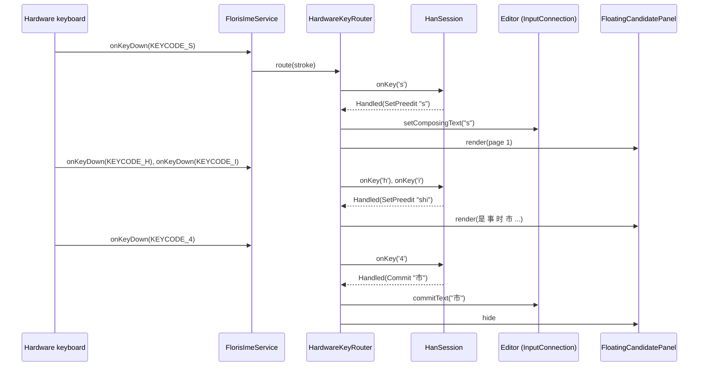
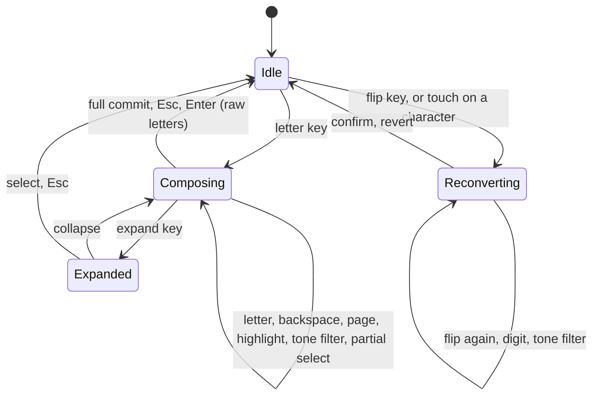
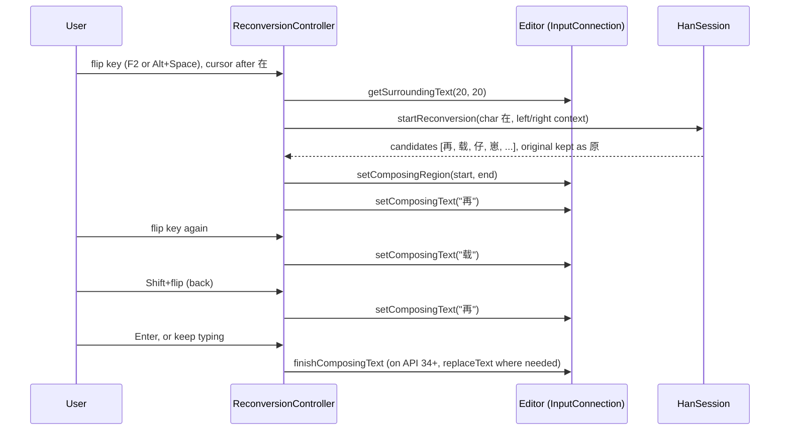
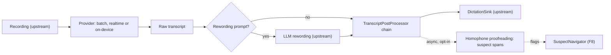
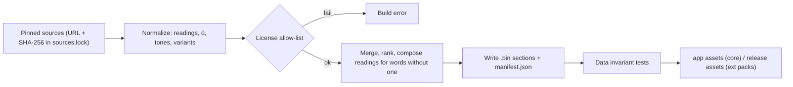
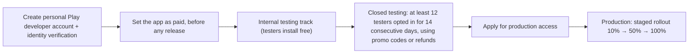

# 字在 Zizai — Architecture

> **A Chinese-first fork of Dictate Keyboard:** LLM dictation, plus Pinyin input built for physical keyboards,
> with exhaustive homophone flipping that also works on text you have already dictated.

| | |
|---|---|
| **Status** | Draft 0.4 — all product decisions made ([§12](#12-decisions-and-open-questions)) |
| **Date** | 2026-10-26 |
| **Name** | **字在** (Latin name: *Zizai*), a pun on 自在 ("at ease"). Rationale and store listing in [§8.4](#84-name-and-store-listing). |
| **Upstream baseline** | [`DevEmperor/DictateKeyboard`](https://github.com/DevEmperor/DictateKeyboard) `main` @ `39f33c9` (2026-10-24), app **6.4.0** (versionCode 142) |
| **Package / namespace** | App: `io.zizai.keyboard`. New code: `io.zizai.*`. Proposed: register `zizai.io` or adjust this before the first Play upload. |
| **Where this file lives** | Planning copy. Move it to `docs/ARCHITECTURE.md` in the fork once the fork exists. |

**How to read this:** §0 is the one-page summary. §4 has the decisions and why each was made. §6 is the
detailed design. §8 is the Google Play plan. §10 is the roadmap.

---

## Contents

0. [Summary](#0-summary)
1. [Goals, non-goals, users](#1-goals-non-goals-users)
2. [What we are forking](#2-what-we-are-forking)
3. [Research findings that shape the design](#3-research-findings-that-shape-the-design)
4. [Architecture decisions](#4-architecture-decisions)
5. [System overview](#5-system-overview)
6. [Detailed design](#6-detailed-design)
7. [Repository, fork and build strategy](#7-repository-fork-and-build-strategy)
8. [Google Play release plan](#8-google-play-release-plan)
9. [Testing strategy](#9-testing-strategy)
10. [Roadmap](#10-roadmap)
11. [Risks and mitigations](#11-risks-and-mitigations)
12. [Decisions and open questions](#12-decisions-and-open-questions)
13. [References](#13-references)
- [Appendix A — Default keymap](#appendix-a--default-keymap)
- [Appendix B — Planned upstream hooks](#appendix-b--planned-upstream-hooks)
- [Appendix C — Glossary](#appendix-c--glossary)

---

## 0. Summary

**What "Dictate" is today.** Dictate is no longer the small Java dictation keyboard it started as. In June
2026 (v4.0.0) it was rebuilt as a full keyboard on top of **FlorisBoard**: Kotlin and Jetpack Compose,
Apache-2.0, about 20 provider presets for speech and rewording, streaming and on-device recognition, AI
rewording. In August 2026 it gained basic
Pinyin ([upstream issue #262](https://github.com/DevEmperor/DictateKeyboard/issues/262)). That Pinyin
support is a prefix lookup in one SQLite table with a 32-candidate cap. It has **no physical-keyboard
support at all**: the hardware-key handler only intercepts Space, Enter and Shift, so typed letters go
straight to the app.

**What we add**, and the key decisions:

1. **A downstream fork that stays mergeable** (ADR-1). New code lives in new modules and packages.
   Upstream files only get thin, marked hooks. We change `applicationId`, not the Gradle namespace or
   upstream's packages.
2. **An IME-owned, synchronous composition session for Chinese** (ADR-2), replacing upstream's
   "composing word lives in the editor, candidates arrive asynchronously" model for Pinyin. Keyboard
   selection and paging must act on exactly the list the user is looking at.
3. **A pure-Kotlin Pinyin engine** (ADR-3) with a precompiled, memory-mapped lexicon. Cantonese (Jyutping)
   typing reuses the same engine with a second set of readings in Phase 3. **librime** (BSD-3-Clause) stays
   an optional future backend behind the same interface; it is not the starting point.
4. **Hardware mode** (ADR-5): when a physical keyboard is in use, the IME window stays *shown* but visually
   minimal. A floating candidate panel is anchored to the caret through `CursorAnchorInfo`, with
   desktop-class keys: number selection, paging, tone filter, 以词定字, and a one-key "flip".
5. **Homophone flipping in two places.** While composing, you get the complete list of characters for a
   syllable, filterable by tone and character set. On committed text (including dictated text),
   reconversion (改字) flips the character or word before the cursor through its homophones with a live
   preview. This is the fast fix for speech recognition's most common Chinese error.
6. **Script and punctuation normalization** (ADR-6). A converter built on OpenCC's Apache-2.0 data
   handles Simplified (the default), Traditional (Taiwan) and Traditional (Hong Kong). It applies to engine
   output and to transcripts, because Whisper-family models mix scripts.
7. **Speech** (ADR-7). We keep upstream's provider layer. We add Qwen3-ASR-Flash (Alibaba Model Studio),
   a Chinese transcript post-processing chain, hot words from the user dictionary, and **opt-in LLM
   homophone proofreading that flags suspects and never silently rewrites**.
8. **Tiered data licensing** (ADR-4). Permissive data (Unicode License v3, Apache-2.0, MIT) is bundled.
   CC BY-SA or LGPL data ships only as separate, attributed, downloadable packs. GPL data is never used.
9. **Play-first scope** (ADR-8). The fork becomes **字在 (Zizai)**, a paid app with its own icon and
   `applicationId` (§8.4). For v1, Dictate Cloud and billing, the AccessibilityService floating button,
   on-device translation, GIF search and the Wear app are compiled out. We add an in-app "report AI output"
   action, and §8 has the full declaration checklist.

---

## 1. Goals, non-goals, users

### Goals

| # | Goal | Measure of success |
|---|---|---|
| G1 | Dictation-first Chinese: accurate Mandarin dictation (Simplified or Traditional) and Cantonese dictation, with consistent script and punctuation | Script consistency of 99% or better after normalization; CER (character error rate) tracked per provider |
| G2 | First-class Chinese input from a physical keyboard: Bluetooth/USB keyboards, tablet covers, keyboard phones | Every action in Appendix A is reachable without touching the screen |
| G3 | Homophone flipping: browse **every** character or word sharing a pronunciation, and flip committed text in place | Every character in the 8,105-character General Standard table is reachable from each of its readings |
| G4 | Ship on Google Play: policy-compliant and maintainable by one person | Passes review; upstream merges take hours, not days |
| G5 | Stay mergeable with upstream to inherit its dictation features | Monthly merges or better |

### Non-goals for v1

- Distribution in mainland-Chinese app stores. Google Play is not available there, and domestic stores
  need extra filings.
- Handwriting input. The Zhengma/Cangjie/Boshiamy shape methods stay as upstream ships them.
- Cantonese (Jyutping) and Zhuyin *typing* in v1. Cantonese typing is committed for Phase 3 (§12);
  Zhuyin is designed for (§6.2) but not scheduled.
- Our own backend or accounts. The only exception is an optional tiny endpoint for AI-output reports (§8).

### Users

| Persona | Context | What they need most |
|---|---|---|
| **P1: bilingual professional** (Singapore, Malaysia and overseas mainland Chinese first; then Taiwan and Hong Kong) | Dictates messages and email in Chinese, and mixes in English terms | Correct script, quick homophone fixes, English/Chinese switching |
| **P2: keyboard-phone user** | Unihertz Titan 2 Elite, Clicks Communicator and others from the 2026 "keyboard-phone comeback" | Desktop-class Pinyin on a compact QWERTY with no number row and no arrow keys |
| **P3: tablet or foldable writer** | Bluetooth keyboard, long-form writing | Fast paging, a large candidate grid, dictation hotkeys |

**Priority: Simplified Chinese first** (§12). Traditional output ships in v1 through OpenCC. The
Traditional UI and Taiwan/Hong Kong polish follow in Phase 2.

---

## 2. What we are forking

### 2.1 Lineage and stack

- Dictate v1–v3 was a Java app, preserved on the `legacy-java` branch. v4.0.0 (2026-06-15) was a
  **rebuild as a fork of FlorisBoard**. v6.0.0 followed on 2026-08-18 and v6.4.0 on 2026-10-07. The repo
  is now `DevEmperor/DictateKeyboard`, and the old `DevEmperor/Dictate` URL redirects to it.
- The license is **Apache-2.0** for both Dictate and FlorisBoard. `NOTICE` carries the FlorisBoard
  attribution plus the model and data attributions.
- It is on Google Play as `net.devemperor.dictate`, as a paid app.

| Area | Upstream value |
|---|---|
| Language / UI | Kotlin 2.3.20, Jetpack Compose (BOM 2026.03.01) |
| Build | AGP 9.2.1, JDK 17, NDK 29.0.14206865, CMake 4.1.2, build-tools 36.0.0 |
| SDK levels | minSdk 26, targetSdk 36, compileSdk 36 |
| Libraries | OkHttp 5.3, Room 2.8.4, kotlinx-serialization 1.11, JetPref datastore, Play Billing 8.3.0, ML Kit text recognition, Coil 3 |
| Tests | kotest 6.1 (JUnit 5), turbine, MockWebServer |
| Native | sherpa-onnx 1.13.3 + ONNX Runtime 1.24.3 (fetched by `tools/fetch-sherpa-onnx.sh`; arm64-v8a, armeabi-v7a, x86_64). Bergamot translation (built by `tools/bergamot/build-android.sh`; arm64 only). **`preBuild` fails if either is missing.** |
| Modules | `:app`, `:wear`, `:lib:android`, `:lib:color`, `:lib:compose`, `:lib:dictate-core` (providers, prompts, realtime), `:lib:kotlin` (pure JVM), `:lib:snygg` (theming) |
| Identity | Gradle `namespace` = `dev.patrickgold.florisboard`; `applicationId` = `net.devemperor.dictate` |
| Version | `gradle.properties`: `projectVersionCode=142`, `projectVersionName=6.4.0` |
| CI | No workflows in the repo |

### 2.2 Subsystems that matter here

| Subsystem | Where | What it means for us |
|---|---|---|
| IME service | `FlorisImeService.kt` (677 lines) | Puts `ImeRootView` into the window content. `onKeyDown`/`onKeyUp` delegate to `KeyboardManager.onHardwareKeyDown/Up`. `onEvaluateInputViewShown()` is true only with no hardware keyboard, or when the pref `physicalKeyboard.showOnScreenKeyboard` is set. |
| Window | `ime/window/ImeWindowController.kt` | Has FIXED and FLOATING modes. Floating mode reports content/visible insets at the bottom of the root, so the app does not resize, and narrows touch to a region. **We can reuse this for a caret-anchored panel.** |
| Keyboard logic | `ime/keyboard/KeyboardManager.kt` (2,520 lines) | Soft keys enter through `onInputKeyUp(KeyData)`; candidate taps go through `commitCandidate()`. The hardware handler only intercepts **Space, Enter, Shift**. A half-/full-width switch already exists (`activeState.isCharHalfWidth`). |
| Editor | `ime/editor/EditorInstance.kt` (1,177), `AbstractEditorInstance.kt` (769) | The word being composed lives *in the app's field* as a composing region, which is recomputed from the text before the cursor. |
| Suggestions | `ime/nlp/NlpManager.kt` (974) | `suggest()` launches a coroutine and publishes results to `activeCandidatesFlow`. The Smartbar `CandidatesRow` renders them. |
| Chinese | `ime/nlp/han/HanShapeBasedLanguageProvider.kt`, `PinyinPackManager.kt` | One `code/text/weight` table with an indexed prefix range query and **at most 32 candidates**. Serves Zhengma, Cangjie and Boshiamy (bundled) and Pinyin (`zh-CN-pinyin`). The Pinyin pack is downloaded: 3,030,654 bytes, about 170k rows, built from CC-CEDICT plus OpenSubtitles frequencies, licensed **CC BY-SA 4.0**. It is Simplified only. |
| Dictation | `dictate/DictateController.kt` (**5,303 lines**) | Runs recording → provider → optional rewording → `DictationSink`. The sink is either the IME or the accessibility overlay. |
| Providers | `lib/dictate-core/.../ProviderRegistry.kt`, `OpenAiCompatibleClient.kt` | OpenAI (default `gpt-transcribe`; realtime `gpt-live-transcribe`), Gemini (`gemini-3.5-transcribe`), Groq, Mistral, Soniox, ElevenLabs, Deepgram, AssemblyAI, Azure, xAI, **SiliconFlow** (SenseVoiceSmall, TeleSpeechASR; reachable from mainland China), Scaleway, OVHcloud, Ollama, custom. On-device via sherpa-onnx, including **SenseVoice Small** (about 240 MB; zh, yue, en, ja, ko). |
| Prompting | `DictatePromptDefaults.kt`, `CustomWordList.kt` | Per-language "style prompt" sample sentences (`zh-cn` → `你好。非常感谢。`, `zh-tw` → `你好。非常感謝。`). The custom word list is budgeted to Whisper's 224-token prompt window. |
| System voice input | `dictate/recognition/*` | A `RecognitionService` plus a voice-only IME, so other keyboards' mic keys can use Dictate. |
| Floating button | `dictate/overlay/*`, `DictateAccessibilityService` | Uses an AccessibilityService (not declared as an accessibility tool), with a prominent-disclosure dialog. |
| Cloud and billing | `dictate/cloud/*`, provider preset `cloud` → `https://api.dictatekeyboard.com/v1/` | Prepaid credit through Play Billing. **Upstream's backend; must not ship in a fork.** |
| Downloads | `github.com/DevEmperor/DictateKeyboard/releases/download/<tag>` | Release tags include `whisper-models-v1`, `language-packs-v1`, `glide-dicts-v1`, `bigram-dicts-v1`, `trigram-dicts-v1`, `translation-models-v1`. |
| Settings and keys | JetPref datastore | API keys sit in the provider keyring inside the datastore. They are included in the end-to-end encrypted cloud backup on purpose, and the privacy policy says so. |
| UI translations | `res/values-zh-rCN` | 2,464 of 2,497 strings. **No zh-TW or zh-HK.** |

### 2.3 Gap analysis

| Need | Upstream today | Gap we fill |
|---|---|---|
| Pinyin from a physical keyboard | Letters bypass the IME; the candidate strip is hidden when a hardware keyboard is attached (unless you force the on-screen keyboard) | Hardware composition, selection and paging (§6.1–6.3) |
| Deterministic selection | Candidates arrive asynchronously, so a digit pressed early selects from a stale list | Synchronous session (ADR-2) |
| Segmentation and abbreviations | Prefix match on concatenated toneless codes. `xian` cannot become 西安; `zg` cannot become 中国 | Syllable lattice, jianpin, fuzzy pinyin, double pinyin (§6.2) |
| All homophones | Top 32, ordered by code then weight | Exhaustive, lazily paged list with tone and charset filters |
| Fixing committed text | None | Reconversion and flip (§6.5) |
| Learning | No-op in the Han provider | User dictionary with phrase learning |
| Traditional Chinese | Simplified-only pack; no script converter | OpenCC-based output, TW and HK variants, zh-TW UI |
| Transcript cleanup | Style prompt only | Script, punctuation and spacing normalization; suspect flagging |
| Chinese ASR providers | SiliconFlow; Alibaba DashScope rejected upstream "for technical reasons" | Qwen3-ASR-Flash wire format (§6.6) |

---

## 3. Research findings that shape the design

### 3.1 Android IME and hardware-keyboard mechanics

- **Key routing.** When an editor with an input connection has focus, the framework offers key events to the
  current IME (`InputMethodService.onKeyDown`/`onKeyUp`) *before* the app. Returning `true` consumes the
  event. System shortcuts (Home, Assistant, Meta chords handled by the window manager) never reach the IME.
  So the IME can implement full hardware Pinyin, but **it must decide synchronously** whether to consume
  each key.
- **Showing UI while a hardware keyboard is attached.** The default `onEvaluateInputViewShown()` hides the
  IME when a hardware keyboard is present. fcitx5-android has an established pattern (LGPL-2.1, so study
  it, don't copy it; see `FcitxInputMethodService.kt` and `InputDeviceManager.kt`):
  - Always report the input view as shown, and hide its *content* in hardware mode.
  - Show a floating candidate view positioned from `onUpdateCursorAnchorInfo`.
  - In `onComputeInsets`, report the app's content area as the full window and make only the panel touchable.
  - Return to the touch keyboard when the editor is tapped with a finger or stylus (`onUpdateEditorToolType`,
    API 34) or on `onViewClicked`.
  - Anchor bottom-left when the editor does not report cursor geometry.
  - Switch candidate paging to "paged" for hardware and "scrolling row" for touch.
- **Microphone access depends on the IME being *shown*.** AOSP binds a visible IME with
  `BIND_INCLUDE_CAPABILITIES` (`IME_VISIBLE_BIND_FLAGS` in `InputMethodBindingController.java`). The IME
  then inherits the foreground app's while-in-use capabilities, including the microphone, but only while it
  is shown. **In hardware mode, the IME window must stay shown (even if visually empty) whenever dictation
  hotkeys should work.**
- **APIs and their levels** (minSdk is 26, so we need fallbacks):

  | API | Level | Use |
  |---|---|---|
  | `InputConnection.setComposingRegion` | old | Mark committed text as composing, for reconversion preview |
  | `InputConnection.getSurroundingText` | 31 | Context for reconversion and ranking |
  | `requestCursorUpdates(mode, filter)` | 33 | Cheaper cursor-geometry updates |
  | `InputConnection.replaceText` | 34 | Atomic replacement at the end of reconversion |
  | `InputMethodService.onUpdateEditorToolType` | 34 | Touch versus hardware mode switching |
  | `onCustomImeSwitcherButtonRequestedVisible` | 36 | Optional: draw our own IME-switcher button |

- **Android 16 (targetSdk 36) predictive back.** `KEYCODE_BACK` is no longer dispatched to activities. A
  physical Esc arrives as `KEYCODE_ESCAPE` and reaches the IME normally. Test that cancel works with both
  Esc and the system Back gesture.
- **Compact (BlackBerry-style) keyboards** have no number row and usually no arrows or Ctrl. Digits and
  symbols come from Alt or Sym layers. Interpret keys through `KeyEvent.getUnicodeChar(metaState)` and
  `KeyCharacterMap`, not raw key codes. fcitx5-android shipped a fix for exactly this ("select candidates
  or input digits/punctuations with combination keys properly on some phones with physical keyboards").
- **Shortcuts vary by OS version and OEM.** Ctrl+Space stopped switching languages in Android 7.0, and
  some OEMs add their own (Samsung users report Shift+Space). **Every hotkey must be remappable**, and
  defaults avoid Meta.

### 3.2 Chinese engines and data: licensing is the binding constraint

Licenses below come from each project's license file, source headers or GitHub license metadata, checked
2026-10-26.

| Project / dataset | License | Verdict for an Apache-2.0 app |
|---|---|---|
| **librime** (Rime engine) | BSD-3-Clause | ✅ Viable optional native backend (Phase 3) |
| rime-luna-pinyin, rime-essay (Rime data) | LGPL-3.0 | ⚠️ Only as a separate downloadable pack, if ever |
| rime-ice (雾凇), rime-frost (白霜) | GPL-3.0 | ❌ Do not use: it would force GPL on the app |
| Trime (同文) | GPL-3.0 | ❌ Reference only |
| fcitx5-android | LGPL-2.1 | ⚠️ Design reference only |
| libime (fcitx) | LGPL-2.1-or-later (SPDX source headers) | ❌ Not needed |
| libpinyin | GPL-3.0 | ❌ |
| **OpenCC** | Apache-2.0 | ✅ Data and algorithm for Simplified/Traditional conversion |
| opencc4j | Apache-2.0 | ✅ Possible Java implementation (last push 2025-09) |
| **AOSP PinyinIME** | Apache-2.0 | ✅ `rawdict_utf16_65105_freq.txt`: 65,105 entries with frequencies. A permissive core lexicon. |
| **Unihan** (UAX #38 revision for Unicode 18.0) | Unicode License v3 | ✅ Readings (`kMandarin`, `kHanyuPinyin`, `kXHC1983`, `kTGHZ2013`, `kHanyuPinlu` with frequencies), `kTGH` (General Standard table position, which gives levels 1/2/3), variants, `kTotalStrokes`, Big5/GB mappings |
| mozillazg `pinyin-data`, `phrase-pinyin-data` | MIT *on the repo*, but the merged files include zdic.net-scraped and CC-CEDICT-derived data | ⚠️ Don't treat merged files as MIT. Use only Unihan-derived inputs, or derive from Unihan directly. |
| CC-CEDICT | CC BY-SA 4.0 | ⚠️ Already behind upstream's downloadable Pinyin pack. Keep it a separate, attributed pack. |
| jieba `dict.txt` | MIT | ✅ Word frequencies |
| **rime-cantonese** (Cantonese Jyutping lexicon, by CanCLID) | CC BY 4.0; its `jyut6ping3.maps` file is ODbL 1.0 | ✅ Cantonese words, phrases and frequencies, with attribution. Skip the ODbL file. |
| words.hk (粵典) | Dictionary content is non-commercial without separate permission (per third-party listings and its CC BY-NC research release) | ❌ Not in a paid app |
| CC-Canto (Pleco) | CC BY-SA 3.0 | ⚠️ Not needed; rime-cantonese covers it |
| TypeDuck (Cantonese IME) | GPL-3.0 | ❌ Reference only |

**Consequence.** A clean, permissive *core* is achievable: character readings and tiers from Unihan, a
base lexicon and frequencies from AOSP PinyinIME, and conversion tables from OpenCC. Modern vocabulary
and better ranking come from upstream's CC BY-SA pack, re-packaged as an optional download. GPL
dictionaries are off-limits.

### 3.3 Speech recognition for Chinese

- **Upstream's curated defaults** (from its provider registry, verified by the maintainer in Sep–Oct 2026):
  - OpenAI: `gpt-transcribe` for batch (2026-07; about $0.0045/min per upstream notes) and
    `gpt-live-transcribe` for streaming. Upstream notes that `whisper-1`, `gpt-4o-transcribe` and
    `gpt-4o-mini-transcribe` leave the API on **2027-02-26**.
  - Gemini: `gemini-3.5-transcribe`.
  - SiliconFlow: `FunAudioLLM/SenseVoiceSmall`, reachable from mainland China.
  - On-device: SenseVoice Small, under the FunASR Model License v1.1, which requires attribution.
- **Qwen3-ASR-Flash** (Alibaba Cloud Model Studio) is a good fit for Chinese:
  - It speaks an OpenAI-compatible **`chat/completions`** API with an `input_audio` part (a URL or a base64
    data URL of at most 10 MB), not `/audio/transcriptions`.
  - Workspace endpoints exist in Beijing and **Singapore**.
  - It covers Mandarin (including Sichuanese, Minnan and Wu) and Cantonese, accepts glossary-style context
    in a system message, and does inverse text normalization (ITN) for zh and en.
  - Upstream rejected DashScope for technical reasons. That makes it a differentiator for us, but it needs a
    new wire format.
- **Qwen3-ASR open weights** (0.6B/1.7B, Apache-2.0, reported January 2026) are a self-hosting option behind
  an OpenAI-compatible server. Running them on-device is unverified.
- **Whisper-family models mix Simplified and Traditional output.** A target-script prompt helps but is not
  guaranteed, so normalize with OpenCC.
  - Traditional → Simplified is near-deterministic.
  - Simplified → Traditional is one-to-many (发 → 發/髮). OpenCC's phrase tables resolve most cases, so
    prefer asking the model for the target script and use OpenCC as the guarantee.

### 3.4 Google Play constraints (October 2026)

| Topic | Requirement | Impact |
|---|---|---|
| Target API | Since 2026-08-31, new apps and updates must target **API 36**; extension available to 2026-11-01 | Upstream already targets 36. Expect API 37 next year (annual cadence). |
| 16 KB pages | Apps targeting 35+ must support 16 KB pages on 64-bit devices. **Updates that don't will be blocked from 2027-02-01.** AGP ≥ 8.5.1 and NDK ≥ r28 align by default. | Verify the prebuilt `.so` files (sherpa-onnx and ONNX Runtime; Bergamot if translation returns) in CI |
| New personal accounts | Created after 2023-11-13: closed test with **≥12 testers opted in for 14 consecutive days** before production access. Organization accounts are exempt. | Recruit testers early (§8) |
| Developer verification | Required for apps on certified devices from **2026-09-30** in Brazil, Indonesia, Singapore and Thailand; global from 2027 (per news reports) | Matters if you also distribute APKs outside Play |
| Data safety | Sending audio or text off the device is "collection". Processing only on the device is not. Exemptions for user-initiated transfers and ephemeral processing exist but must be justified. | Draft answers in §8.3 |
| AI-generated content | Apps that generate content with AI must let users **report or flag offensive output in-app**, without leaving the app | Rewording and voice commands are generation from user prompts, so add a report action |
| Accessibility API | Only real accessibility tools may set `isAccessibilityTool`. Others need prominent disclosure, consent and a Play Console declaration. | The floating button is out of v1 |
| Spam / repetitive content | Apps that "merely provide the same experience as other apps" are not allowed | The Chinese features are the differentiation. Never ship a re-skinned Dictate. |
| Impersonation / IP | Apache-2.0 grants no trademark rights (§6 of the license) | New name, icon and listing art |
| Availability | Google Play is not available in mainland China | Mainland users sideload; SiliconFlow and on-device paths matter for them |

### 3.5 Hardware landscape

The 2026 keyboard phones include the **Unihertz Titan 2 Elite** (Android 16, with every key programmable
for short and long press), the **Clicks Communicator** (Android 16), the **Minimal Phone** and the
**Ikko MindOne Pro**. Add tablets and foldables with Bluetooth keyboards, Samsung DeX, and ChromeOS. Two
layout families result:

- **Full keyboards:** number row, arrows, Ctrl, Tab, Esc.
- **Compact keyboards:** letters plus Alt/Sym layers.

The keymap needs presets for both (Appendix A).

---

## 4. Architecture decisions

Each decision is written so it can be challenged later. If one changes, update it here first.

### ADR-1 — A downstream fork with seams

- **Context.** Upstream ships several commits a day, and its central files are large (`DictateController`
  5.3k lines, `KeyboardManager` 2.5k).
- **Decision.**
  - Fork on GitHub and keep an `upstream` remote.
  - Put new features in **new modules and packages** (`io.zizai.*`).
  - Touch upstream files only through **one-line hooks** marked `// ZIZAI-HOOK:`. These delegate to our code.
  - Use our own preference store, strings file (`strings_zizai.xml`), settings route and keyboard
    extension asset.
  - Change `applicationId`. **Keep** the Gradle `namespace` and upstream's Kotlin packages.
  - Read our version from a separate file, so upstream version bumps never conflict.
- **Consequences.** Merges are frequent and small, with predictable conflict hot spots (Appendix B).
  Nothing is offered upstream (decided, §12), so the hooks are permanent. Keeping each one to a single line
  is what keeps merges cheap.
- **Rejected.** Renaming packages (never mergeable again). Forking `legacy-java` (dead, and not a full
  keyboard).

### ADR-2 — An IME-owned, synchronous Han composition session

- **Context.** In upstream, the composing word lives in the editor, and candidates are computed in a
  coroutine. That suits autocorrect. It is wrong for hardware selection: `s h i 4` must select from exactly
  the list on screen. Some editors also mangle composing text, and reconversion needs exact control.
- **Decision.**
  - `HanSession` (in `:lib:han-engine`) owns the raw key buffer, the segmentation, the candidate pages and
    the highlight.
  - Every key is processed **synchronously on the main thread** within a latency budget.
  - The editor only receives the rendered preedit (`setComposingText`) and commits.
  - While a session is active, upstream's composing-region reconciliation is bypassed (one hook).
  - The **same session** serves touch and hardware input.
  - The upstream Han provider remains only for the shape-based methods.
- **Consequences.** Key handling becomes deterministic, and touch typing gains segmentation and paging too.
  We need engine performance discipline (§6.10) and hooks in `KeyboardManager` and `EditorInstance`.

### ADR-3 — A pure-Kotlin engine first; librime as an optional later backend

- **Decision.**
  - `:lib:han-engine` is plain Kotlin/JVM with no Android dependencies.
  - It defines a `ConversionBackend` interface. The default `LexiconBackend` reads a precompiled,
    memory-mapped lexicon.
  - A `RimeBackend` (JNI to librime) may come in Phase 3 *if* sentence-level quality or more schemas (more
    double-pinyin variants, Zhuyin, Cangjie) become the priority.
- **Why.**
  - The signature features (exhaustive homophones, tone and charset filters, reconversion of committed text,
    keyboard-first paging) need *direct lexicon access*. We would have to build that even on top of librime.
  - The core needs no NDK build, runs its tests on the JVM in seconds, is license-clean, and adds roughly
    5 MB.
- **Costs.** We own segmentation and ranking quality. Whole-sentence conversion (整句) starts with a
  word-unigram Viterbi; a bigram language model comes later.
- **Rejected for now.**
  - *librime first.* It is mature, but brings a heavy native build (boost, leveldb, marisa, yaml-cpp,
    opencc), a YAML "deploy" step, and its best dictionaries are LGPL or GPL. We would still need our own
    reading index.
  - *fcitx5/libime.* LGPL and heavier.
  - *AOSP PinyinIME's native decoder.* Apache-2.0, but a 2009-era codebase that is no longer maintained.
    We take its dictionary, not its code.

### ADR-4 — A precompiled binary lexicon with tiered data licensing

- **Decision.**
  - A build-time tool compiles the sources into `han-core.bin` (bundled, permissive) and optional
    `han-ext-*.bin` packs (downloaded, separately licensed, each with its own `LICENSE` and attribution).
  - The runtime memory-maps them.
  - User data lives in Room.
  - The builder enforces a **license allow-list** and fails on GPL inputs.
- **Why not SQLite like upstream?** Building the syllable lattice takes dozens of lookups per keystroke.
  Memory-mapped sorted arrays and tries avoid JNI, cursors and allocations. SQLite stays for user data.

### ADR-5 — Hardware mode: the IME window stays shown, plus a caret-anchored panel

- **Decision.**
  - While an editor is focused and Chinese or dictation features are enabled, `onEvaluateInputViewShown()`
    returns true.
  - In hardware mode the root view draws only two things: a **floating candidate panel**, while composing or
    reconverting, and a small **status pill** (中/英, mic, recording).
  - Insets: the app is not resized, and the touchable region is the panel plus the pill.
  - This reuses the inset approach of `ImeWindowController`'s floating mode.
- **Why.** Candidates must appear near the caret, and the mic only works while the IME is shown (§3.1).
  This also matches what desktop IME users expect.
- **Fallback.** A bottom-docked compact bar, used when `CursorAnchorInfo` is unavailable or the user
  prefers it.

### ADR-6 — Script and punctuation normalization in a shared pure-JVM module

- **Decision.** `:lib:zh-text` provides:
  - An OpenCC-compatible converter: OpenCC's Apache-2.0 dictionaries compiled to compact tries, with
    maximum forward matching over the phrase table, then the character table, then regional variants.
  - Locale-aware punctuation normalization and optional CJK–Latin spacing.
  - Both the engine output and the transcripts use it.
  - **Alternative.** `android.icu.text.Transliterator` ("Hans-Hant") only converts character by
    character; keep it as a fallback, not the default.

### ADR-7 — Speech: upstream's provider layer plus a post-processing chain

- **Decision.**
  - Keep `ProviderRegistry` and `OpenAiCompatibleClient`.
  - Add a `QWEN_CHAT_AUDIO` transcription API implemented in a *new* file, with a one-line dispatch hook.
  - Decorate the dictation sink with a `TranscriptPostProcessor` chain.
  - Feed hot words from the user dictionary into the prompt or context, within upstream's token budget.

### ADR-8 — Play-first product scope

- **Decision.**
  - **Paid upfront**, with no in-app purchases, so the app never calls the Play Billing Library. The
    library stays compiled in but unused, because upstream's cloud code depends on it.
  - Build flags turn off Dictate Cloud (and with it billing), the floating button (AccessibilityService),
    on-device translation (Bergamot), GIF search (KLIPY) and the `:wear` app.
  - Add an in-app **"Report AI output"** action.
  - Use a new identity and a rewritten privacy policy.
- **Why.** Fewer declarations and less review surface for a first submission, no native build that needs
  Linux, and no route that sends users to upstream's paid backend. Each feature can come back later with its
  declaration done.

---

## 5. System overview

### 5.1 Components



### 5.2 Modules

| Module | Kind | Status | Contents |
|---|---|---|---|
| `:app` | Android app | Upstream + hooks | IME, UI, dictation. New code under `io.zizai.*` (Android glue only). |
| `:lib:dictate-core` | Android library | Upstream + 1 new file + 1 hook | `QwenAsrClient.kt` (new); dispatch hook in `OpenAiCompatibleClient`; presets in `ProviderRegistry` |
| `:lib:han-engine` | **Kotlin/JVM (new)** | New | `HanSession`, parsers, lattice, lexicon reader, ranker, homophone index, learning model (storage-agnostic) |
| `:lib:zh-text` | **Kotlin/JVM (new)** | New | OpenCC converter, punctuation and spacing normalizers, suspect-span model |
| `:tools:han-dict-builder` | **Kotlin/JVM app (new)** | New | Builds `.bin` packs from sources; license gate; data-invariant tests |
| `:wear`, other `:lib:*` | Upstream | Unchanged | `:wear` is excluded from the Play v1 release |

Package layout inside `:app`:

```text
io.zizai
├── ime.hardware      HardwareKeyRouter, KeyStroke, Keymap, HardwareModeController, DeviceProfiles
├── ime.han           HanImeController, PreeditRenderer, CandidatePresenter, HanSubtypes
├── ime.panel         FloatingCandidatePanel, StatusPill, CandidateGridSheet (Compose)
├── ime.reconvert     ReconversionController, TargetResolver, SuspectNavigator
├── dictation.zh      TranscriptPostProcessingSink, HotwordProvider, ProofreadingClient
├── data              HanPackManager, HanUserStore (Room), ZizaiPrefs (separate datastore)
├── settings          Chinese settings screens, KeymapEditor, PackManagerScreen
└── hooks             ZizaiHooks — the single entry point that upstream hook lines call
```

### 5.3 Typing on a hardware keyboard: `s h i 4` → 市



---

## 6. Detailed design

### 6.1 Hardware keyboard pipeline

**Hook.** `FlorisImeService.onKeyDown/onKeyUp` first calls `ZizaiHooks.keys.onKeyDown(event)`. If that
consumes the event, return `true`. Otherwise, fall through to the existing upstream path, unchanged.

**Normalization.** Each `KeyEvent` becomes a `KeyStroke`:

| Field | Source |
|---|---|
| `keyCode`, `scanCode`, `deviceId`, `source` | From the `KeyEvent` |
| `codePoint` | `event.getUnicodeChar(event.metaState)`, which honours Alt/Sym layers on compact keyboards |
| `modifiers` | Ctrl, Alt, Shift, Meta, Sym, Fn |
| `repeatCount`, `isLongPress` | From the `KeyEvent` |
| Device profile | Full or compact, guessed with `InputDevice.hasKeys(KEYCODE_1, KEYCODE_DPAD_UP, KEYCODE_CTRL_LEFT, …)` plus a user override and per-device presets |

**Routing order.** The first rule that matches decides.

| # | Condition | Action |
|---|---|---|
| 1 | Editor is `TYPE_NULL` (terminals, games), or the package is on the user's bypass list | Pass through |
| 2 | Global hotkey (push-to-talk, dictation toggle, prompt palette, cheat sheet, script toggle) | Consume and act |
| 3 | Reconversion active | Reconversion keymap |
| 4 | Composition active | Composition keymap (Appendix A) |
| 5 | Chinese mode, idle, printable letter | Start composition |
| 6 | Chinese mode, idle, punctuation | Commit full-width punctuation (if enabled) |
| 7 | Shift pressed and released alone | Toggle 中/英 (with a composition active: commit the raw letters first, configurable) |
| 8 | Anything else (Ctrl/Alt/Meta shortcuts, navigation keys while idle, English mode) | Pass through |

**Invariants.**

- **Consume key-down/key-up pairs consistently.** Never consume an up whose down went to the app, or the
  reverse. Otherwise the app sees stuck keys.
- Treat a modifier as a "tap" only when it is pressed and released with no other key in between, within
  300 ms (configurable).
- When a Ctrl chord passes through, the app still sees Ctrl via the next event's `metaState`, even if we
  consumed the Ctrl key-down for push-to-talk detection.
- Auto-repeat: Backspace repeat deletes pinyin letters while composing, and passes through when idle.
- Field type sets the starting mode: `IME_FLAG_FORCE_ASCII` and email, URI, number, phone or password
  fields start in English or pass-through. The 中/英 state can optionally be remembered per app.

**Mode switching** (the behaviour learned from fcitx5-android, implemented independently):

- Enter **hardware mode** on the first printable hardware key in a non-null editor.
- Leave it when the editor is touched with a finger or stylus (`onUpdateEditorToolType`, API 34+), or on
  `onViewClicked` (older APIs).
- Setting: *Auto* (default) / *Always touch keyboard* / *Always hardware mode*.

**Dictation from the keyboard.**

- **Push-to-talk:** hold the configured key (default: Right Ctrl, at least 250 ms with no other key) and
  release to send.
- **Toggle:** Ctrl+Shift+Space.
- **Cancel:** Esc.

These only work while the IME window is shown (ADR-5). The status pill shows recording state and the
upstream live caption.

### 6.2 The Han engine (`:lib:han-engine`)

#### State machine



#### Readings model

The engine is built around one abstraction: a **reading** is a `(phonology, syllable, tone)` triple, with
Mandarin as the first phonology.

- The ≈410 toneless Mandarin syllables (≈1,300 with tones) are indexed as `Short` values.
- Pinyin, double pinyin and Zhuyin are just different *spellings* parsed into the same readings. Adding
  Zhuyin later needs only a new front-end parser. Zhuyin input always carries tone, with the first tone
  typed as Space.
- **Cantonese is committed** (§12) as a second phonology table, not a different engine:
  - Character readings come from Unihan `kCantonese` (Phase 2). Words, phrases and frequencies come from
    rime-cantonese, under CC BY 4.0 (§6.8, Phase 3).
  - The flip uses Cantonese readings whenever the active subtype or dictation language is Cantonese, so it
    can fix Cantonese homophone errors in Cantonese dictation.
  - Cantonese output defaults to Traditional (Hong Kong), even though the app is Simplified-first.

#### Input schemes

| Scheme | Phase | Notes |
|---|---|---|
| Quanpin (全拼) | 1 | `'` separates syllables; `v` stands for ü (`lv`, `nve`) |
| Jianpin (简拼) and mixed | 1 | Initials only, including `zh`/`ch`/`sh`; `zg` → 中国, `zhongg` → 中国 |
| Fuzzy pinyin (模糊音) | 2 | Toggleable pairs: z/zh, c/ch, s/sh, n/l, r/l, f/h, an/ang, en/eng, in/ing, ian/iang, uan/uang |
| Double pinyin (双拼) | 2 | Table-driven: Xiaohe (小鹤), Microsoft (微软), Ziranma (自然码), Sogou, Ziguang, Pinyin Jiajia (拼音加加) |
| Jyutping (粵拼) | 3 | Cantonese. Tones 1–6 optional (Tab cycles the tone filter, as in Pinyin). Optional "lazy-sound" (懶音) fuzzy pairs: n/l, ng-/no initial, gw/g, kw/k, -ng/-n, -k/-t. |
| Zhuyin (注音) | Later | Standard (Dai-Chien) layout, same lexicon |

#### Syllable lattice

- Parse the buffer into a **DAG** of every valid segmentation. A trailing incomplete syllable is allowed
  for prefix completion.
  - `xian` → `xian` | `xi'an`.
  - `fangan` → `fang'an` | `fan'gan`.
- Score paths: prefer full syllables over initials and fewer syllables over more. Fuzzy matches and
  abbreviations take a penalty.

#### Candidate assembly

The list is assembled lazily, one page at a time, and duplicates are removed.

1. **User phrases** that exactly match the whole input.
2. **The best whole-input conversion**, for multi-syllable input. Phase 1 uses a word-unigram Viterbi;
   Phase 3 adds a bigram language model with stupid-backoff scoring.
3. **Words for the longest prefix**, then shorter prefixes. Selecting one commits that part and keeps the
   rest of the buffer composing.
4. **Every single character for the first syllable**: the exhaustive homophone list below.

Candidates are produced as a `Sequence` and are never all materialized. A syllable like `yi` has
hundreds of characters.

#### Exhaustive homophones ("flip through every character with this sound")

- **Ordering.** For a toneless syllable, the postings list is pre-sorted at build time by score:
  - Frequency, using AOSP character counts, or the extended pack's corpus counts when that pack is
    installed.
  - Then tier.
  - Then `kHanyuPinlu` (reading frequency) for polyphones.
  - Then stroke count.
- **Filters**, all available from the keyboard:

  | Filter | Values | Source |
  |---|---|---|
  | Tone | All, 1, 2, 3, 4, neutral | Unihan readings |
  | Charset tier | Common 3,500 (General Standard level 1) / General 8,105 (levels 1–3) / Big5 level 1 (5,401) / Big5 (13,053) / All | `kTGH`, `kBigFive` |
  | Script | Simplified / Traditional / both | Unihan variants and OpenCC |
  | Renderable only | On by default | `Paint.hasGlyph`, cached per character |

- **Expanded grid.** Characters are grouped by tone, each row labelled with its tone-marked pinyin
  (shì / shí / shǐ / shī). Tab cycles the tone filter.
- **以词定字.** While a word is highlighted, `[` or `]` commits its first or last character.

#### Polyphones (多音字)

- Word readings are authoritative: 银行 → yín**háng**.
- On its own, a character's readings are weighted by `kHanyuPinlu` where available, and by dictionary
  order otherwise.

#### Ranking

```text
score = w1·log P_lex(word) + w2·user(count, recency) + w3·LM(context) − penalties(abbrev, fuzzy, rare tier)
```

- **Phase 1:** lexicon frequency plus user boost.
- **Phase 3:** adds the bigram language model and left context from `getSurroundingText`.

#### Learning

- On commit: update counts and recency. A sequence of character or word selections that recurs N times
  becomes a user phrase (造词).
- **Never learn** in incognito mode, in password fields, or when the editor sets
  `IME_FLAG_NO_PERSONALIZED_LEARNING`.
- Ctrl+Delete on a highlighted candidate demotes or blocks it.

#### Chinese punctuation (idle, full-width on)

| Key | Output | Key | Output |
|---|---|---|---|
| `,` | ， | `.` | 。 (keeps `.` after a digit: 3.14) |
| `?` | ？ | `!` | ！ |
| `:` | ： | `;` | ； |
| `\` | 、 | `^` | …… |
| `_` | —— | `<` `>` | 《 》 |
| `"` | “ ” (alternating); 「 」 in TW/HK style | `'` | ‘ ’; 『 』 in TW/HK style |
| `[` `]` | 【 】 (when idle) | `` ` `` | · |

Ctrl+. toggles full- and half-width punctuation. This reuses upstream's `isCharHalfWidth` state.

#### API sketch

```kotlin
interface HanSession {
    val ui: StateFlow<HanUiState>                  // immutable snapshots for the panel and strip
    fun onKey(stroke: KeyStroke): KeyResult        // synchronous; p95 < 2 ms
    fun onCandidateTapped(page: Int, index: Int): KeyResult
    fun startReconversion(target: ReconversionTarget): KeyResult
    fun reset(reason: ResetReason)
}

sealed interface KeyResult {
    data object NotHandled : KeyResult
    data class Handled(val edits: List<EditorEdit>) : KeyResult
}

sealed interface EditorEdit {
    data class SetPreedit(val text: String, val cursor: Int) : EditorEdit
    data class Commit(val text: String) : EditorEdit
    data class MarkComposing(val start: Int, val end: Int) : EditorEdit   // reconversion preview
    data object FinishComposing : EditorEdit
}

interface ConversionBackend {                      // LexiconBackend now, RimeBackend maybe later
    fun candidates(lattice: SyllableLattice, ctx: ConversionContext): Sequence<Candidate>
    fun homophones(reading: Reading, filter: HomophoneFilter): Sequence<Candidate>
    fun readingsOf(text: String, ctx: TextContext): List<ReadingSequence>
    fun learn(event: CommitEvent)
}
```

### 6.3 Candidate presentation

**Touch mode.**

- `HanImeController` publishes pages to the Smartbar row, bypassing `NlpManager.suggest()` and its async
  path.
- A Han candidate tapped through `KeyboardManager.commitCandidate()` is routed back to the session (hook).
- An expand chevron opens a `CandidateGridSheet` with tone tabs and filter chips.

**Hardware mode** (floating panel):

```text
┌──────────────────────────────────────────────────────────┐
│ shi▏                                ◂ 1/41 ▸   声调: 全部 │
│ 1是  2事  3时  4市  5使  6十  7实  8式  9视                 │
└──────────────────────────────────────────────────────────┘
   ↓ expands to a grid (Tab cycles the tone filter; arrows move; Enter selects)
┌──────────────────────────────────────────────────────────┐
│ shì  是 事 市 示 世 式 视 室 试 势 适 释 饰 逝 誓 侍 …      │
│ shí  时 十 实 识 石 食 拾 什 蚀 …                          │
│ shǐ  使 始 史 驶 屎 矢 …                                  │
│ shī  师 失 施 诗 湿 狮 尸 虱 …                              │
└──────────────────────────────────────────────────────────┘
```

**Positioning.**

1. Request cursor updates with monitoring and an immediate update (using cursor-update filters on API 33+).
2. Take the caret rectangle from `CursorAnchorInfo`: the insertion marker, or the composing text's
   character bounds. Map it to screen coordinates with the info's matrix, minus the IME window's own
   screen location.
3. Place the panel below the caret line. Flip it above if there is no room, and keep it clear of display
   cutouts and system bars. It must work in split-screen, freeform windows and DeX.
4. With no usable geometry, dock it at the bottom.

**Other details.**

- Page size is 9 by default (5–10), horizontal by default, with vertical as an option.
- TalkBack: the panel announces the highlighted candidate (upstream already announces Smartbar actions).
- Theming reuses the Snygg theme tokens so the panel matches the user's keyboard theme.

### 6.4 Rendering the preedit into the editor

| Mode | Behaviour | When to use |
|---|---|---|
| **Inline pinyin** (default) | `setComposingText("ni'hao")`, underlined | Most editors |
| Inline candidate preview | Shows the highlighted candidate as composing text | Optional; mimics macOS-style input |
| Panel-only | Nothing goes into the editor until commit; the preedit shows in the panel | Apps with broken composing support. Driven by a per-package compatibility list the user can edit. |

- Wrap edits in `beginBatchEdit`/`endBatchEdit`.
- Watch `onUpdateSelection` (its `candidatesStart/End`). If the app drops the composition (for example,
  it cleared the field), reset the session rather than fight the app.

### 6.5 Reconversion (改字) and flip — fixing committed and dictated text



**Triggers.**

- The flip key while idle: F2 or Alt+Space by default, remappable.
- Touch: tap the 改 chip in the Smartbar, or long-press a character's position.
- *Next suspect* (F8) after an LLM proofreading pass (§6.7).

**Choosing what to reconvert.**

1. A non-empty selection of up to 8 Han characters → reconvert the whole selection as a word.
2. Otherwise, the Han character before the cursor. Indexes are by code point, because Extension B and
   later characters are surrogate pairs.
3. Ctrl+flip widens the target to the lexicon word that contains the cursor, found by segmenting the
   surrounding text.

**Finding readings.**

- Look up the word first; that disambiguates polyphones. Fall back to per-character readings.
- Traditional text: convert to Simplified for lookup (`t2s`), then map the candidates back to the user's
  script (`s2tw`/`s2hk`).

**Ranking.** Use the context score (Phase 3 language model with left and right neighbours) plus frequency.
The original stays reachable as **原**.

**Applying the change.**

- Preview with `setComposingRegion` plus `setComposingText`.
- Confirm with `finishComposingText`.
- Revert with `setComposingText(original)` plus `finishComposingText`.
- On API 34+, use `replaceText` for an atomic final replacement in editors that ignore composing regions.
- **Read back after each step.** If the text does not match, abort and restore.

**Edge cases.**

- The app moves the cursor mid-flip: cancel.
- Emoji or Latin next to the target.
- Fields that disallow composing.
- Very long fields: only read a ±64-character window.

### 6.6 Dictation for Chinese



**Post-processor chain** (pure JVM, in `:lib:zh-text`). It runs on the final text and in a light form on
streaming previews.

1. **Whitespace cleanup.** Remove spaces between Han characters (Whisper sometimes inserts them).
2. **Punctuation normalization by locale.** ASCII punctuation next to Han becomes full-width. Quotes follow
   the user's style: “” for zh-Hans; 「」 by default for zh-Hant-TW and zh-Hant-HK, configurable.
   `...` → ……, `--` → ——.
3. **Script normalization** (OpenCC): `s2t`, `s2tw`, `s2twp` (with Taiwan phrasing), `s2hk`, `t2s`.
   Streaming deltas are converted locally, and the final pass fixes any phrase that was split across
   deltas.
4. **Optional CJK–Latin spacing** (盘古之白), off by default.
5. **Upstream find-and-replace rules** (unchanged).
6. **Suspect detection** (async, never blocks the commit). See §6.7.

**Vocabulary biasing.**

- `HotwordProvider` takes the top-K user phrases and names, and adds them to the Whisper-style `prompt`
  within upstream's `CustomWordList` budget. CJK costs about 1–2 tokens per character, so K is small.
- For Qwen, the same list goes into the context system message as a glossary.

**Providers to add.**

- `TranscriptionApi.QWEN_CHAT_AUDIO`, implemented in a new `QwenAsrClient.kt`:
  - `POST {base}/chat/completions` with `model = qwen3-asr-flash`.
  - The user message carries `input_audio` as a `data:audio/...;base64,` URL.
  - `asr_options` carry `language` and `enable_itn`.
  - Presets: *Alibaba Model Studio (Singapore)* and *(Beijing)*. Both need a workspace-specific base URL,
    so the base URL must be editable.
- Encoding: base64 inflates audio by a third, and the limit is 10 MB. Upstream can only encode AAC/m4a
  (Android has no MP3 encoder), and on its existing chat-audio route it sends WAV, because that route is
  documented as WAV or MP3 only.
  - Send m4a if Qwen accepts it; check the format list in the API reference.
  - Otherwise send WAV. At 16 kHz mono, about 3.5 minutes fits under the limit. Upstream's long-form
    segmentation splits anything longer.

**Language choices** map onto each provider's codes. Mandarin (Simplified) is the default:

| Choice | Output script |
|---|---|
| Mandarin (Simplified) | zh-Hans |
| Mandarin (Taiwan) | zh-Hant-TW |
| Cantonese (Hong Kong) | zh-Hant-HK |
| Auto | User's preferred script |

Upstream's `DictateLanguages` already has zh-CN, zh-TW, yue-CN and yue-HK.

**Offline.** SenseVoice Small stays the default on-device Chinese model. A streaming Chinese on-device
model (Paraformer or Zipformer via sherpa-onnx) is a Phase 3 evaluation.

**Evaluation.** Keep a small labelled Mandarin/Cantonese test set and a script that reports CER and script
consistency per provider and model. Re-run it after each upstream merge that touches providers.

### 6.7 LLM features for Chinese

**Built-in Chinese prompts.**

| Prompt | Purpose |
|---|---|
| 润色 | Polish |
| 改为书面语 | Make formal |
| 口语化 | Make casual |
| 纠正同音错别字 | Fix homophone typos; returns a diff, see below |
| 中英互译 | Translate between Chinese and English |
| 总结 | Summarize |
| 简繁转换 | Simplified/Traditional conversion. **Local, no LLM.** |

**Homophone proofreading contract.**

- Opt-in, off by default, and **with no default model**. Turning it on requires picking a provider and
  model from the ones the user has configured. Until then the switch stays disabled and says why.
- The model must return JSON. It must not rewrite the text:

```json
{
  "suspects": [
    { "start": 12, "end": 13, "original": "在", "suggestions": ["再"], "confidence": 0.86, "hint": "再见" }
  ]
}
```

- The client validates that every span's `original` matches the text at `[start, end)` (code-point
  offsets). Invalid entries are dropped, and the list is capped (for example, 20).
- Suspects are kept with the **dictation span**: where the text was inserted, and the inserted string. They
  stay valid until the user edits outside that span, or until a read-back no longer matches.
- **F8 / Shift+F8** jump to the next or previous suspect: select it and open reconversion with the LLM's
  suggestions first. Nothing changes without the user's confirmation.

**Smart convert (experimental, Phase 3).** Send a long pinyin string plus surrounding context to an LLM,
and offer the result as a single candidate. It is opt-in because of latency and cost.

**Policy hook.** Every AI-produced result (reworded text, command output, proofreading suggestions) has a
**Report** action (§8).

### 6.8 Data architecture

#### Datasets

| Dataset | License | Ships as | Purpose |
|---|---|---|---|
| Unihan (readings, `kHanyuPinlu`, `kTGH`, `kBigFive`, `kGB0`, variants, `kTotalStrokes`) | Unicode License v3 | `han-core.bin` (bundled) | Character readings, tiers, variants, strokes |
| AOSP PinyinIME `rawdict_utf16_65105_freq.txt` | Apache-2.0 | `han-core.bin` | Base lexicon and frequencies |
| OpenCC dictionaries | Apache-2.0 | `zh-convert.bin` (bundled) | Script conversion |
| jieba `dict.txt` (optional) | MIT | `han-core.bin` | Frequency smoothing for words AOSP lacks |
| Upstream Pinyin pack (CC-CEDICT readings + OpenSubtitles counts) | CC BY-SA 4.0 | `han-ext-modern.bin` (downloaded) | Modern vocabulary and better ranking |
| rime-essay / luna-pinyin (only if needed) | LGPL-3.0 | `han-ext-rime.bin` (downloaded) | Phrase weights for the Phase 3 language model |
| Unihan `kCantonese` | Unicode License v3 | `han-core.bin` (bundled) | Cantonese character readings, so the flip works on Cantonese text (Phase 2) |
| rime-cantonese: `jyut6ping3` dictionaries and `essay-cantonese.txt` | CC BY 4.0 (attribution, no share-alike) | `han-ext-yue.bin` (downloaded) | Cantonese characters, words and phrases with Jyutping, plus frequencies, for Jyutping typing (Phase 3) |
| rime-cantonese `jyut6ping3.maps` | ODbL 1.0 (share-alike database license) | **Not used** | — |
| words.hk (粵典) dictionary content | Non-commercial without separate permission | **Never** in the paid app | — |
| GPL dictionaries (rime-ice, rime-frost, libpinyin) | GPL-3.0 | **Never** | — |

#### Build pipeline: `:tools:han-dict-builder`



- **Determinism.** The same inputs produce the same bytes. The manifest records each source's hash and
  license and the output hashes. Every pack ships `LICENSE` and `ATTRIBUTION.md`, with the CC BY-SA
  attribution following the pattern upstream already uses.
- **Invariant tests**, for example:
  - Every character in the 8,105-character General Standard table has at least one reading, and appears in
    the postings list of each of its readings.
  - Every syllable in the inventory has postings.
  - No input carries a GPL license.

#### Binary format (sketch)

```text
han-core.bin
  header      magic "ZZHN", format version, build hash, section table
  syllables   ~410 toneless entries + tone variants; spelling tables (pinyin, zhuyin)
  chars       code point → reading list (syllable, tone, weight), tier bits, stroke count, variant links
  postings    syllable → [char, tone, score] sorted by score   ← exhaustive homophone lists
  words       syllable-id sequence trie (double-array or LOUDS) → word ids
  wordtab     word id → text offset, quantized log-frequency (u8), flags
  strings     UTF-8 blob
```

- **Loading.** Store assets uncompressed (`androidResources { noCompress += "bin" }`) and memory-map them
  from the `AssetFileDescriptor`, or copy them once to `noBackupFilesDir`. Downloaded packs are verified by
  size and SHA-256 and installed atomically, following upstream's `PinyinPackManager` pattern.
- **User data.** A Room database `zizai_han_user` with tables `user_phrase(text, reading, count,
  last_used, source)` and `blocked_candidate(text, reading)`. Add it to `data_extraction_rules.xml`,
  alongside upstream's user dictionary. Offer JSON export and import.
- **Size estimates** (to be confirmed by the builder): core about 4–6 MB uncompressed; modern pack about
  10–20 MB; RAM use is mostly page cache.

### 6.9 Settings and onboarding

A new **中文 / Chinese** settings group, stored in our own datastore (`ZizaiPrefs`) so it never conflicts with
upstream's `AppPrefs`:

| Group | Settings |
|---|---|
| Input | Scheme (Quanpin / double-pinyin variant / Jyutping in Phase 3 / Zhuyin later); fuzzy pairs, including Cantonese lazy sounds; Shift-tap behaviour |
| Candidates | Page size, orientation, pinyin annotations, charset tier, show rare characters, renderable-only |
| Output | Script (简 by default / 繁·台 / 繁·港); punctuation style; full-width default; CJK–Latin spacing |
| Hardware keyboard | Mode (Auto / Touch / Hardware); keymap preset (Full / Compact / device presets); **keymap editor** ("press the key to bind"); per-app bypass list; panel position |
| Reconversion | Flip key; word mode; LLM suggestions first |
| Dictation | Hotkeys; hot-word biasing; proofreading (stays off until the user picks a provider and model; shows a disclosure) |
| Data | Packs (download, delete, size, license), user dictionary editor, export/import, clear learning |

**Onboarding.** The first time a hardware keyboard is detected, show a dismissible card with the six
essential keys. **Ctrl+/** opens a full cheat sheet at any time.

### 6.10 Threading, performance, reliability

| Budget (mid-range device, p95) | Target |
|---|---|
| `HanSession.onKey` | < 2 ms |
| Key-down to `setComposingText` issued | < 8 ms |
| Panel frame after a page change | < 8 ms (no jank at 120 Hz) |
| Engine cold load (memory-map plus index warmup) | < 150 ms, off the main thread |

- **Main thread:** routing, the session step, editor edits and producing the render snapshot. **Never
  suspend in the key path.**
- **Startup:** load the engine on `onCreate` on a background thread. Until it is ready, queue up to N
  letters; if loading fails, pass keys through and show a notice.
- **Hot paths:** no allocations in inner loops (reuse arrays and primitive collections). Add engine and
  panel paths to upstream's `baseline-prof.txt`.
- **Failure containment:** any exception inside the session resets it, passes the key through and writes a
  local log. A bug may cost a keystroke; it must never wedge the keyboard.

### 6.11 Security and privacy

- **Editor flags.** Respect them all: password fields (no composing, no learning),
  `IME_FLAG_NO_PERSONALIZED_LEARNING`, and incognito.
- **API keys.** Keep upstream's approach: the datastore, included in the end-to-end encrypted cloud backup,
  as stated in its privacy policy. Wrapping keys with Android Keystore would break restores on a new phone.
  This trade-off is deliberate, and our privacy policy must say so.
- **Network.**
  - HTTPS by default.
  - Plain `http://` only for user-configured LAN servers (upstream behaviour). Answer the Data safety
    "encrypted in transit" question with that in mind.
  - No analytics SDKs. Crash logs stay on the device.
- **What leaves the device.** Audio and text go only to the provider the user configured. LLM proofreading
  sends text, so it is opt-in, has no default model (the user chooses one), and is disclosed at the point
  of enabling.

---

## 7. Repository, fork and build strategy

### 7.1 Setting up the fork

1. Fork `DevEmperor/DictateKeyboard` on GitHub under your account and rename it, for example `zizai`.
2. Clone it under this folder, then add upstream as a second remote:

```bash
git clone https://github.com/<you>/zizai.git
```

```bash
git -C zizai remote add upstream https://github.com/DevEmperor/DictateKeyboard.git
```

3. Move this file to `zizai/docs/ARCHITECTURE.md` and commit it as the first fork-specific change.

**Public source (decided, §12).** Use GitHub's Fork button in step 1, which also shows "forked from
DevEmperor/DictateKeyboard" on the repository page. Because everything is public:

- Never commit the upload key, `keystore.properties` or `.env` files (upstream's `.gitignore` already
  excludes them), or credentials such as the AI-report endpoint's. Keep them in GitHub Actions secrets.
- Keep the LICENSE and NOTICE files, and add our own attributions (§7.3).
- Anyone may build, sideload or republish the code under Apache-2.0. The license grants no trademark
  rights, so registering 字在 / Zizai is what stops copies from using the name (§12).

**Branches.**

- `main`: the product.
- `sync/upstream-YYYY-MM-DD`: a merge branch for each upstream sync. Open a PR from it, run CI, then
  merge.
- Releases are tagged `zizai-v<major>.<minor>.<patch>`.

### 7.2 Keeping merges cheap

- Every upstream file we touch gets a one-line header comment for Apache-2.0 §4(b) ("Modified by Zizai
  contributors") and **`// ZIZAI-HOOK:`** lines that delegate to `ZizaiHooks`. Nothing else.
- New strings go in `res/values*/strings_zizai.xml`. New subtypes go in our own keyboard-extension asset,
  not upstream's `extension.json`.
- Our version code and name live in `zizai.properties`. One build-script hook reads it, so upstream's
  `gradle.properties` bumps never conflict.
- Merge every 1–2 weeks. Small merges are cheap; quarterly merges are painful.
- No upstream contributions (decided, §12). Every hook stays in the fork for good, so keep each to a
  single line and merge often.

### 7.3 Rebranding checklist

- [ ] `applicationId` → `io.zizai.keyboard` (after the trademark checks in §8.4). Keep `namespace`
      unchanged.
- [ ] App name: 字在 in Chinese locales, Zizai elsewhere. Also the launcher icon, IME label, notification
      texts and Play listing art. Never reuse upstream's screenshots or icon.
- [ ] Turn off Dictate Cloud: build flag `ZIZAI_CLOUD=false` hides the `cloud` provider preset and
      screens. The release manifest drops the billing permission; the Billing Library stays compiled in,
      unused, because removing it would mean cutting upstream's cloud code out of the build.
- [ ] Release-only overrides in new files, not edits to upstream's: `app/src/release/AndroidManifest.xml`
      removes the services and permissions of the features switched off in v1, and
      `app/src/release/res/values{,-zh}/strings_zizai.xml` sets the app name.
- [ ] Other v1 flags:
  - `ZIZAI_FLOATING_BUTTON=false` (AccessibilityService).
  - `ZIZAI_TRANSLATE=false` (on-device translation): skip the `verifyBergamotLib` check, leave out
    `libdictate_bergamot.so`, and hide the Translate entry point.
  - `ZIZAI_GIF=false`.
  - `:wear` excluded from the release bundle.
- [ ] URLs: issue tracker, privacy policy, website, "What's new" links, crash-report targets.
- [ ] Download hosts: mirror the models, dictionaries and packs we use to **our own** release assets, with
      their licenses and attributions, instead of pulling from upstream's GitHub releases.
- [ ] About screen and `NOTICE`: "字在 (Zizai) is based on Dictate Keyboard by DevEmperor, itself a fork
      of FlorisBoard." Keep all existing attributions; add ours for new data (Unihan, AOSP PinyinIME,
      OpenCC).
- [ ] Rewrite the privacy policy (upstream's describes Dictate Cloud and its own operator).

### 7.4 Building on Windows

- Install Android Studio with SDK Platform 36, build-tools 36.0.0, NDK **29.0.14206865**, CMake 4.1.2 and
  JDK 17. No Android SDK was found at the default location on this machine.
- `tools/fetch-sherpa-onnx.sh` is a bash script. Run it in Git Bash; it needs `curl`, `sha256sum` and
  **Python 3**, which it uses to unpack the AARs. Python is not installed on this machine yet: `python`
  only opens the Microsoft Store.
- **Bergamot isn't needed for v1.** `tools/bergamot/build-android.sh` (on-device translation) builds native
  code from Mozilla's sources and expects a Linux toolchain (WSL2 or CI). With `ZIZAI_TRANSLATE=false`, the
  build skips the check that would otherwise fail `preBuild` without `libdictate_bergamot.so`.
- **Testing setup:**
  - Daily work: your **Pixel 8 Pro** with a Bluetooth keyboard.
  - Emulators for API 26–33, because the Pixel 8 Pro can't run anything older than Android 14 and minSdk
    is 26. Give one AVD a hardware keyboard (`hw.keyboard = yes`).
  - A 16 KB page-size system image. The Pixel 8 Pro's own 16 KB developer option needs an unlocked
    bootloader and a wipe, so use the emulator.

### 7.5 Continuous integration

Upstream has no CI workflows, so we add GitHub Actions:

| Workflow | Steps |
|---|---|
| `ci.yml` (each PR) | Fetch the sherpa-onnx libs → build the debug APK → JVM tests (kotest) for `:lib:han-engine`, `:lib:zh-text`, `:lib:dictate-core` → Android lint → data license gate |
| `data.yml` | Run `:tools:han-dict-builder` from `sources.lock` → invariant tests → upload pack artifacts |
| `release.yml` (on tag) | Build the AAB → 16 KB checks (`zipalign -c -P 16 -v 4`, ELF `LOAD` alignment ≥ 2¹⁴ for every arm64 `.so`) → upload to the Play internal track (Gradle Play Publisher or fastlane) |

v1 builds run with `ZIZAI_TRANSLATE=false`, so CI needs no Bergamot build. If translation comes back, build
the `.so` on a Linux runner and cache it.

---

## 8. Google Play release plan

### 8.1 Account and timeline



- **Personal account (decided).** A personal account created after 2023-11-13 must pass a closed test
  with at least 12 testers opted in for 14 consecutive days before production access opens.
- **Paid app (decided): set the price before the first release of any kind.** Once an app has been offered
  for free, it can never become paid; the only way back is a new app with a new package name. Paid → free
  stays possible later.
- **Closed testers of a paid app must buy it.** Only internal testers (up to 100) install paid apps free,
  and the 12-tester rule needs a *closed* test. Two ways to make it free for testers:
  - **Promo codes** for the app: up to 500 per quarter, shared between the paid app and one-time products.
    The help page doesn't say whether codes work before a production release, so confirm this in Play
    Console when the closed test starts.
  - **Refunds** from Play Console's order management after testers buy.
- **Recruit 15–20 testers, not 12.** Testers who opt out before day 14 don't count, so a buffer protects
  the clock. Simplified-Chinese communities first (Singapore, Malaysia, overseas mainland users), then
  Bluetooth-keyboard and keyboard-phone users.
- **Selling makes you a "trader" under the EU Digital Services Act.** App stores publish traders' contact
  details (address, phone, email) to EU users. Apple documents its process; Google's equivalent page wasn't
  found during research, so check Play Console's account settings for the trader declaration. To keep a
  home address private, use a business address or PO box, or leave EU countries out of distribution.
- **Fees.** Google's 2026 fee structure applies in the US, UK and EEA (from 2026-06-30) and in Australia and
  Japan (from 2026-09-30). It includes a separate 5% billing fee on a paid app's first purchase. Elsewhere,
  the older 15% fee on the first $1M of annual earnings still applies. Check the fee page when you set the
  price.
- **Merchant profile.** Selling requires a Google payments merchant profile linked to the developer account.

### 8.2 Pre-flight checklist

| Item | Action |
|---|---|
| Identity | 字在 / Zizai, `io.zizai.keyboard`, new icon (§8.4). Run the trademark searches before the first upload. |
| Signing | Play App Signing with a new upload key (never upstream's) |
| Target API | 36 (already). Plan API 37 for 2027. |
| 16 KB | CI checks pass for every `.so` |
| Privacy policy | Rewritten for the fork, hosted (for example on GitHub Pages), linked in Play Console **and** in the app |
| Prominent disclosure | Before the first cloud transcription: what is sent (audio, and text for rewording or proofreading), to whom (the selected provider), and why. Upstream's setup flow is the base; adjust the wording. |
| Data safety | See §8.3 |
| Permissions | `RECORD_AUDIO`, `INTERNET`, `POST_NOTIFICATIONS`, `VIBRATE`, `MODIFY_AUDIO_SETTINGS`. Foreground service types: `dataSync` (model downloads), `microphone` and `shortService` only if the features using them stay in. **Fill in the Play Console foreground-service declaration for each type that ships.** |
| Accessibility | Not used in v1 (floating button off). If it comes back: Play Console declaration, prominent disclosure and consent, demo video. |
| AI-generated content | In-app **Report** on AI output. Reports go to a minimal HTTPS endpoint (for example a small serverless function) or an in-app form that queues them. Declare this in Data safety if it carries text. |
| Content rating | IARC questionnaire. With GIF search off, user-generated content exposure is minimal. |
| Ads | None |
| Target audience | 13+ (or 18+). Not designed for children. |
| App access | Tell reviewers that **on-device SenseVoice works without any API key**; give the steps and optionally a restricted test key |
| Store listing | Titles and short descriptions per language in §8.4. Feature graphic and localized screenshots showing the hardware panel, homophone flip and dictation. |
| Payments | **Paid upfront** (decided). Set the price before the first release; needs a merchant profile. No in-app purchases in v1; anything added later must use Play Billing, and the Play build has no external payment links. |
| EU trader status | Declare it (selling makes you a trader). Decide which address EU users will see (§8.1). |
| Repetitive content | The listing leads with what is unique: physical-keyboard Pinyin, homophone flipping, script normalization |

### 8.3 Data safety: draft answers (re-check against the form's wording at submission)

| Data type | Collected? | Shared? | Notes |
|---|---|---|---|
| Audio — voice or sound recordings | Yes, when a cloud provider is selected | Disclose as shared with the user-selected provider, unless you are confident the user-initiated exemption applies | Not retained by us; processed ephemerally on the device; the provider's own retention applies |
| App activity — other user-generated content (dictated, reworded or proofread text) | Yes, when rewording or proofreading is used | As above | Same |
| AI-output reports | Yes, only when the user taps Report | No | Only if the report endpoint exists |
| Personal identifiers, location, contacts, device IDs | No | No | Contact names are only picked through the system picker into the local dictionary (upstream) |
| Purchase history or financial info | No | No | Google Play handles the paid download; the app sees no payment data |
| Encrypted in transit | Yes for HTTPS providers | — | Explain the user-configured LAN `http://` exception, or restrict cleartext to private address ranges |
| Deletion | Nothing is stored on our side | — | Local data is deletable in the app |

### 8.4 Name and store listing

**Name: 字在 (Zizai).**

- **One name in every script.** 字 and 在 are written identically in Simplified and Traditional Chinese,
  so one logo works in mainland China, Hong Kong and Taiwan.
- **A pun that survives Cantonese.** 字在 is an exact homophone of 自在 ("at ease, free") in Mandarin
  (zìzài) and in Cantonese (zi6 zoi6). 自在 brings to mind 自由自在, 逍遙自在 and the Heart Sutra's 觀自在.
- **The name demonstrates the product.** The app fixes homophone errors, and its name is a deliberate
  homophone. Easter-egg idea: reconverting 自 in 自在 offers 字 first.
- **Latin name.** "Zizai" is short and easy for non-Chinese speakers to say. Use it in non-Chinese
  listings, always next to 字在 or a descriptor (see the conflict checks below).

| Tagline | Meaning |
|---|---|
| 說得自在，字字都在 / 说得自在，字字都在 | "Speak at ease; every character lands" |
| 心想字成 | A pun on the greeting 心想事成: "think it, and it's written" |
| 名字是故意的同音字，你的訊息不會是。/ 名字是故意的同音字，你的信息不会是。 | "Our name is a deliberate homophone. Your messages won't be." |

**Conflict checks** (2026-10-26):

| Check | Result | Action |
|---|---|---|
| Play titles 字在 and 自在 | No app uses either | — |
| Play title "Zizai" | Taken by an unrelated app (Mayhew Walker Consulting, `mayhew.zizai.info`; its category wasn't visible) | Never use "Zizai" on its own |
| Companies | "Beijing Zizai Technology" (maker of Nut trackers) exists | Include it in the trademark search |
| Domains | `zizai.com`, `zizai.app` and `getzizai.com` are registered. `zizai.io` and `zizaikey.com` had no RDAP record. | Register `zizai.io` to back `io.zizai.keyboard` |
| Trademarks | **Not searched yet** | Search TIPO (Taiwan), IPD (Hong Kong) and CNIPA (mainland) before the first upload |
| Names to avoid | Puns on 自然 would look like a knock-off of Taiwan's long-standing 自然輸入法 | — |

**What people search for** (Google Play, 2026-10-26):

| Query | What ranks | Takeaway |
|---|---|---|
| "chinese dictation" | #1 and #4 are titled exactly "Chinese Dictation"; the rest are Chinese-learning apps | In English, "dictation" mostly means listening drills, so this query reaches learners |
| "chinese voice typing" | #1 is titled exactly "Chinese Voice Typing Keyboard" | Exact-match titles win where no big brand dominates |
| 語音輸入 (Taiwan) | Google's apps, Typeless, an app titled just 語音轉文字, 語聲 AI 語音輸入法, SoundType ("AI聽寫") | People search 語音輸入 and 語音轉文字. 聽寫 mostly means school drills. |
| 廣東話語音輸入 (Hong Kong) | #1 is OmuType, a Cantonese voice keyboard with a keyword-packed 30-character title | Direct competitor. Lead with 廣東話, and use 粵語 too. |

**Titles** (30-character limit; each language listing has its own title):

| Listing | Title | Length |
|---|---|---|
| English | Zizai: Chinese Voice Dictation | 30 |
| Taiwan (zh-TW) | 字在：AI語音輸入法・語音轉文字 | 16 |
| Hong Kong (zh-HK) | 字在：廣東話語音輸入・語音轉文字 | 16 |
| Simplified (zh-CN) | 字在：AI语音输入法・语音转文字 | 16 |

The English title matches "chinese dictation", "chinese voice" and "voice dictation". If keyboard users
matter more than learners, use "Zizai: Chinese Voice Typing" (27) instead.

**Simplified first** (§12). The zh-CN listing is the primary Chinese listing, so its screenshots come first.
The Taiwan and Hong Kong listings can launch with the copy below; Traditional-Chinese screenshots follow in
Phase 2.

**Short descriptions** (80-character limit):

| Listing | Short description | Length |
|---|---|---|
| English | Chinese speech to text & voice typing keyboard. Mandarin, Cantonese, Pinyin. | 76 |
| Taiwan | 開口就打字：國語、廣東話語音輸入與語音轉文字，繁簡自動轉換，實體鍵盤也能一鍵改同音錯字。 | 44 |
| Hong Kong | 開口就打字：廣東話（粵語）及普通話語音輸入、語音轉文字，繁簡自動轉換，支援實體鍵盤。 | 42 |
| Simplified | 开口就打字：普通话、粤语语音输入与语音转文字，简繁自动转换，实体键盘一键改同音错字。 | 42 |

The Hong Kong copy leaves out "fix homophones with one key" on purpose. The v1 flip uses Mandarin
readings, so it can't fix Cantonese homophone errors until Cantonese character readings ship in Phase 2.
Add the claim to the Hong Kong listing then, and mention Cantonese typing once Jyutping ships in Phase 3.

**Full description.**

- Write normal sentences, and put the key terms in the first lines, which show without scrolling:
  dictation, voice typing, speech to text, Mandarin / 國語 / 普通話, Cantonese / 廣東話 / 粵語, Pinyin,
  Traditional and Simplified, Bluetooth and physical keyboards.
- Mention 自在 once, because people who hear the name will type 自在.
- Describe only features that have shipped.

**Rules that get listings rejected** (Play's Metadata policy, which applies to every translation):

- Titles must be 30 characters or less, with no emoji, emoticons or repeated special characters, and no
  ALL CAPS unless it's part of the brand.
- No ranking or promotional words in the title, icon or developer name: "#1", "Best", "Popular", "New",
  "Free", "No Ads", discounts.
- No repetitive or unrelated keywords, and no lists of words in descriptions.

**What decides ranking after launch.**

- **Conversion from search results:** the icon, the first screenshots (with Chinese UI in each Chinese
  listing) and the rating.
- **Stability:** apps over Android vitals' bad-behavior thresholds become less discoverable. The overall
  thresholds are a 1.09% user-perceived crash rate and a 0.47% user-perceived ANR rate. Reaching 8% on a
  single device model hurts visibility on that model.
- **Narrow searches first:** win low-competition queries ("cantonese voice typing", "pinyin bluetooth
  keyboard", 繁體語音輸入), then broader terms as installs grow.
- **Measurement:** Play Console's acquisition reports (Grow users → Store performance) break traffic down
  by search term. Adjust the title and short description from that data.
- **Custom store listings** can target user segments, such as separate pitches for Taiwan, Hong Kong and
  Malaysia/Singapore.

### 8.5 Regional notes

- Mainland China: Play is unavailable. Users who sideload get SiliconFlow and on-device recognition.
  Domestic app stores need extra filings; out of scope.
- If APKs are also published on GitHub, register the package under Android developer verification. It is
  enforced on certified devices in Brazil, Indonesia, Singapore and Thailand from 2026-09-30, and globally
  in 2027.

---

## 9. Testing strategy

| Layer | What | Tools |
|---|---|---|
| Engine unit | Parser, lattice, jianpin, fuzzy, double-pinyin tables; ranking golden files (input → top-N); homophone completeness; learning | kotest (JVM), property tests (kotest-property) for parse/print round-trips |
| Data | Invariants (§6.8), license gate, size budget | Builder test task |
| Text | OpenCC conversions against OpenCC's own test cases; punctuation and spacing rules | kotest |
| Integration | `HanImeController` against a fake `InputConnection` that records edits (preedit, commit, region) | JVM fakes |
| Instrumented | Real editors: `EditText`, Compose `TextField`, WebView/Chrome; reconversion read-back; panel placement | AndroidX Test, UiAutomator |
| Hardware simulation | Key injection | `adb shell input keyevent KEYCODE_S`; emulator with `hw.keyboard = yes` |
| Devices | **Owned:** Pixel 8 Pro with a Bluetooth keyboard (full layout). **Emulators:** API 26, 30 and 33 for the pre-Android 14 fallbacks, plus a 16 KB image. **Closed testers:** Samsung (One UI, DeX), keyboard phones (Titan 2 Elite, Clicks Communicator) for compact layouts, tablets | Manual matrix. Play Console's pre-launch report adds automated runs on real devices. |
| Apps | Chrome, Gmail, Google Docs, Telegram, WhatsApp, WeChat (if installed), Notion, Termux (`TYPE_NULL`), a game | Manual matrix |
| Performance | Keystroke latency, panel frame time, cold start. The Pixel 8 Pro is a high-end phone, so also check the budgets on a low-end emulator profile or an inexpensive device. | Macrobenchmark (upstream has a `:benchmark` module, currently disabled), custom trace sections |
| Dictation quality | CER and script consistency per provider | Evaluation script and test set (§6.6) |
| 16 KB | Runs on a 16 KB system image | `adb shell getconf PAGE_SIZE` returns `16384` |

---

## 10. Roadmap

The work breakdown, schedule and owners are in [IMPLEMENTATION_PLAN.md](IMPLEMENTATION_PLAN.md).

| Phase | Scope | Exit criteria |
|---|---|---|
| **0 — Fork and foundation** (1–2 weeks) | Fork and rebrand; flags for cloud, floating button, translation, GIF and wear; set the app as paid before the first upload; CI; 16 KB checks; release to the internal track | Signed AAB on the internal track; CI green |
| **1 — MVP** | Hardware key router and mode switching; `HanSession` with quanpin and jianpin; exhaustive homophones with tone and tier filters; floating panel; Chinese punctuation; OpenCC output (zh-Hans by default; zh-Hant-TW, zh-Hant-HK); transcript post-processing; reconversion of the character before the cursor (flip); Report action | Closed test running (15–20 testers with promo codes, 14 days); Appendix A works on the Pixel 8 Pro with a Bluetooth keyboard; p95 key latency met |
| **2 — Depth** | Word and selection reconversion; learning and user dictionary UI; fuzzy pinyin; double-pinyin schemes; keymap editor and compact presets (validated by testers with keyboard phones); touch candidate grid; Qwen3-ASR-Flash provider; hot-word biasing; LLM homophone proofreading with suspect navigation (no default model); zh-TW UI strings and Traditional screenshots; Cantonese character readings (Unihan `kCantonese`) so the flip works on Cantonese dictation | Production launch |
| **3 — Quality and reach** | **Cantonese typing (Jyutping)** with the rime-cantonese lexicon; bigram language model for sentence conversion; streaming on-device Chinese model; stroke-filter mode; librime backend evaluation; Zhuyin if demand appears | Cantonese typing shipped; measured CER and keystroke savings improve |

---

## 11. Risks and mitigations

| Risk | Likelihood | Impact | Mitigation |
|---|---|---|---|
| Upstream churn makes merges painful | High | Medium | ADR-1 seams, single-line hooks, merges every 1–2 weeks |
| Public source lets anyone build, sideload or republish the app for free, upstream included | High | Medium | Register the 字在 / Zizai trademark and file IP complaints against copies that use the name; compete on updates, support and the store listing. Upstream sells its app the same way. |
| Editors mishandle composing text or cursor geometry (WebView, Compose, games, terminals) | High | Medium | Panel-only preedit mode, bottom-anchor fallback, per-app overrides, read-back verification |
| Compact keyboards and OEM key handling vary | High | Medium | `KeyCharacterMap`-based interpretation, keymap editor, device presets from beta testers |
| System-reserved shortcuts differ by OEM or version | Medium | Low | Everything remappable; defaults avoid Meta |
| Engine quality falls short of Sogou/Gboard expectations | Medium | High | Lead with word-level conversion and homophones; bigram language model in Phase 3; librime backend as a fallback |
| Data licensing contamination | Medium | High | Builder license gate, `sources.lock`, GPL never allowed |
| Play rejection (Accessibility, foreground services, AI content, Data safety, repetitive content) | Medium | High | v1 scope cuts (ADR-8), Report action, careful declarations, clear differentiation |
| The 12-tester rule delays launch, and closed testers must buy the paid app | High | Medium | Recruit 15–20 testers early; give them promo codes, or refund their purchases (§8.1) |
| Paid upfront means fewer installs, which slows search ranking | High | Medium | Strong localized screenshots, launch posts in target communities, promo codes for reviewers. Switching paid → free later is allowed; free → paid is not. |
| Selling publishes your contact details to EU users (DSA trader status) | Medium | Medium | Use a business address or PO box, or leave EU countries out (§8.1) |
| Compact-keyboard bugs go unnoticed, since you own only a full-size Bluetooth keyboard | Medium | Medium | Keyboard-phone owners among the closed testers; compact presets ship only after their feedback |
| Mic fails when the IME window is hidden | Medium | Medium | Keep the window shown in hardware mode (ADR-5); test on every OEM |
| LLM proofreading alters text or surprises users about privacy | Medium | Medium | Flag-only contract, opt-in, disclosure |
| Provider and model deprecations (OpenAI on 2027-02-26) | High | Low | Inherit upstream registry updates through merges |
| Name or trademark conflict | Medium | Medium | An unrelated Play app is titled "Zizai", and a "Beijing Zizai Technology" exists. Always pair Zizai with 字在 or a descriptor, and search TIPO, HK IPD and CNIPA before the first upload (§8.4). |
| Searchers who hear the name type 自在, not 字在 | Medium | Low | Mention 自在 in the full description; the Latin name "Zizai" also helps |

---

## 12. Decisions and open questions

### Decided (2026-10-27)

| # | Question | Decision | Where it changed the design |
|---|---|---|---|
| 1 | Name and package | **字在 / Zizai**, `io.zizai.keyboard` | §8.4. Before the first upload: trademark searches (TIPO, HK IPD, CNIPA) and registering `zizai.io` |
| 2 | Script priority | **Simplified Chinese first.** No Zhuyin in v1. | Simplified is the default output (§6.6, §6.9); zh-TW UI moves to Phase 2 (§10); the zh-CN listing is the primary Chinese listing (§8.4) |
| 3 | Developer account | **Personal** | The 12-tester, 14-consecutive-day closed test applies (§8.1) |
| 4 | Monetization | **Paid upfront** | The app is paid from its very first release, and closed testers must buy it (§8.1, §8.2, §11) |
| 5 | v1 scope | **The floating button and on-device translation stay out of v1**, alongside Dictate Cloud, GIF search and Wear | ADR-8 and §7.3 flags. No Bergamot build or WSL2 needed for v1 (§7.4). |
| 6 | Upstream contributions | **None.** Nothing is offered back to Dictate Keyboard. | ADR-1, §7.2: every hook stays in the fork permanently, so each stays a single line, and merges happen often |
| 7 | Test hardware | **Pixel 8 Pro and a Bluetooth keyboard** | §9. Emulators cover older Android versions; closed testers cover compact keyboards. |
| 8 | Cantonese | **Typing too (Jyutping)**, not just dictation | §6.2 readings, §6.8 data (rime-cantonese, CC BY 4.0), §10: Cantonese readings for the flip in Phase 2, Jyutping typing in Phase 3 |
| 9 | Proofreading model | **No default model.** Users must pick a provider and model before proofreading can be turned on. | §6.7, §6.9, §6.11 |
| 10 | Repository visibility | **Public source code**, as a regular GitHub fork | §7.1. Anyone, upstream included, may reuse the code under Apache-2.0, so the protected asset is the 字在 / Zizai name: register the trademark (§11). Never commit signing keys or secrets. |

### Before the first Play upload

No product questions remain open. These tasks still have to happen before the first upload, because that
upload fixes the package name and starts the paid-app clock:

- [ ] Trademark searches in Taiwan (TIPO), Hong Kong (IPD) and mainland China (CNIPA). With public source
      code, also consider *registering* 字在 / Zizai, so copies of the code can't use the name.
- [ ] Register `zizai.io` (backs `io.zizai.keyboard`).
- [ ] Choose the address EU users will see for trader status (§8.1).
- [ ] Confirm in Play Console that promo codes work for closed testers of a paid app (§8.1).

---

## 13. References

**Upstream and related code**
- Dictate Keyboard (README, NOTICE, source): <https://github.com/DevEmperor/DictateKeyboard>
- Upstream issue #262, "Chinese input is inadequate": <https://github.com/DevEmperor/DictateKeyboard/issues/262>
- FlorisBoard: <https://github.com/florisboard/florisboard>
- fcitx5-android (floating candidates and input-device switching, LGPL-2.1, reference only): <https://github.com/fcitx5-android/fcitx5-android> and <https://f-droid.org/en/packages/org.fcitx.fcitx5.android/>
- AOSP IME binding flags: <https://android.googlesource.com/platform/frameworks/base/+/refs/heads/main/services/core/java/com/android/server/inputmethod/InputMethodBindingController.java>

**Android APIs**
- `InputMethodService` reference: <https://developer.android.com/reference/android/inputmethodservice/InputMethodService>
- API diffs, InputMethodService: [API 34](https://developer.android.com/sdk/api_diff/34/changes/android.inputmethodservice.InputMethodService), [API 36](https://developer.android.com/sdk/api_diff/36/changes/android.inputmethodservice.InputMethodService)
- API diffs, InputConnection: [API 31](https://developer.android.com/sdk/api_diff/31/changes/android.view.inputmethod.InputConnection), [API 34](https://developer.android.com/sdk/api_diff/34/changes/android.view.inputmethod.InputConnection)
- Android 16 behaviour changes: <https://developer.android.com/about/versions/16/behavior-changes-16>
- Ctrl+Space removal in Android 7.0 (Sony support): <https://www.sony.co.th/en/electronics/support/accessories/articles/SX572401>

**Chinese input engines and data**
- librime: <https://github.com/rime/librime> · Trime: <https://github.com/osfans/trime> · rime-ice: <https://github.com/iDvel/rime-ice> · rime-frost: <https://github.com/gaboolic/rime-frost> · luna-pinyin: <https://github.com/rime/rime-luna-pinyin> · essay: <https://github.com/rime/rime-essay>
- libime: <https://github.com/fcitx/libime> · libpinyin: <https://github.com/libpinyin/libpinyin>
- OpenCC: <https://github.com/BYVoid/OpenCC> · opencc4j: <https://github.com/houbb/opencc4j>
- AOSP PinyinIME: <https://android.googlesource.com/platform/packages/inputmethods/PinyinIME/>
- Unihan (UAX #38): <https://www.unicode.org/reports/tr38/> · Unicode License v3: <https://www.unicode.org/license.txt>
- pinyin-data: <https://github.com/mozillazg/pinyin-data> · phrase-pinyin-data: <https://github.com/mozillazg/phrase-pinyin-data>
- jieba: <https://github.com/fxsjy/jieba> · CC-CEDICT: <https://www.mdbg.net/chinese/dictionary?page=cc-cedict>
- rime-cantonese (CC BY 4.0; `jyut6ping3.maps` ODbL): <https://github.com/rime/rime-cantonese> · CC-Canto (CC BY-SA 3.0): <https://cantonese.org/about.html>
- words.hk licensing (third-party summary): <https://jyutjyu.com/en/about> · words.hk dataset paper: <https://repository.eduhk.hk/en/publications/wordshk-a-comprehensive-cantonese-dictionary-dataset-with-definit-2/>

**Speech**
- Qwen-ASR API reference (Model Studio): <https://help.aliyun.com/en/model-studio/qwen-asr-api-reference>
- Qwen3-ASR 1.7B (third-party packaging; upstream license Apache-2.0): <https://huggingface.co/OpenASR/qwen3-asr-1.7b>
- sherpa-onnx: <https://github.com/k2-fsa/sherpa-onnx>
- Whisper Simplified/Traditional discussions: <https://github.com/openai/whisper/discussions/277>, <https://github.com/openai/whisper/discussions/987>

**Google Play**
- Target API requirements: <https://developer.android.com/google/play/requirements/target-sdk>
- 16 KB page sizes: <https://developer.android.com/guide/practices/page-sizes>
- Testing requirements for new personal accounts: <https://support.google.com/googleplay/android-developer/answer/14151465>
- AI-generated content: <https://support.google.com/googleplay/android-developer/answer/13985936>
- Data safety: <https://support.google.com/googleplay/android-developer/answer/10787469>
- AccessibilityService API: <https://support.google.com/googleplay/android-developer/answer/10964491>
- Spam and minimum functionality: <https://support.google.com/googleplay/android-developer/answer/9899034>
- Developer verification timeline (news): <https://www.androidauthority.com/android-sideloading-changes-timeline-3679204/>
- Metadata policy: <https://support.google.com/googleplay/android-developer/answer/9898842>
- Best practices for your store listing: <https://support.google.com/googleplay/android-developer/answer/13393723>
- Android vitals bad-behavior thresholds: <https://support.google.com/googleplay/android-developer/answer/9844486>
- Acquisition reports (search terms): <https://support.google.com/googleplay/android-developer/answer/9859173>
- ASO checklist (vendor): <https://www.apptweak.com/en/aso-blog/app-store-optimization-aso-checklist-for-google-play>
- Play searches for §8.4 (2026-10-26): [chinese dictation](https://play.google.com/store/search?q=chinese%20dictation&c=apps&hl=en&gl=US), [chinese voice typing](https://play.google.com/store/search?q=chinese%20voice%20typing&c=apps&hl=en&gl=US), [語音輸入 (TW)](https://play.google.com/store/search?q=%E8%AA%9E%E9%9F%B3%E8%BC%B8%E5%85%A5&c=apps&hl=zh-TW&gl=TW), [廣東話語音輸入 (HK)](https://play.google.com/store/search?q=%E5%BB%A3%E6%9D%B1%E8%A9%B1%E8%AA%9E%E9%9F%B3%E8%BC%B8%E5%85%A5&c=apps&hl=zh-HK&gl=HK), [字在](https://play.google.com/store/search?q=%E5%AD%97%E5%9C%A8&c=apps&hl=zh-TW), [zizai](https://play.google.com/store/search?q=zizai&c=apps)
- Existing "Zizai" app: <https://play.google.com/store/apps/details?id=mayhew.zizai.info>
- App pricing (paid → free only): <https://support.google.com/googleplay/android-developer/answer/6334373>
- Testing tracks (closed testers buy paid apps; internal testers don't): <https://support.google.com/googleplay/android-developer/answer/9845334>
- Promo codes: <https://support.google.com/googleplay/android-developer/answer/6321495>
- Service fees: <https://support.google.com/googleplay/android-developer/answer/112622>
- 16 KB developer option on Pixel 8 / 8 Pro: <https://android-developers.googleblog.com/2024/08/adding-16-kb-page-size-to-android.html>
- EU DSA trader requirements (Apple's documentation, for comparison): <https://developer.apple.com/help/app-store-connect/manage-compliance-information/manage-european-union-digital-services-act-trader-requirements>

**Hardware**
- Android phones with physical keyboards, 2026: <https://www.bgr.com/2216085/android-phones-with-physical-keyboards-you-can-buy-in-2026/>
- Unihertz Titan 2 Elite: <https://www.androidauthority.com/unihertz-titan-2-elite-qwerty-android-phone-3634132/>

---

## Appendix A — Default keymap

Every binding is remappable in the keymap editor.

**Full keyboard: while composing**

| Action | Key |
|---|---|
| Select the highlighted candidate | Space |
| Select candidate *n* on this page | 1–9, 0 |
| Next / previous page | `=` / `-`, PageDown / PageUp |
| Move the highlight | ← / → (↑ / ↓ in vertical layout) |
| Expand to grid / collapse | ↓ / Esc |
| Cycle tone filter | Tab / Shift+Tab |
| First / last character of the highlighted word (以词定字) | `[` / `]` |
| Commit the raw letters | Enter |
| Cancel | Esc |
| Delete a letter / a syllable | Backspace / Ctrl+Backspace |
| Demote or block the highlighted candidate | Ctrl+Delete |
| Commit raw letters and switch to English | Shift (tap) |

**Full keyboard: while idle**

| Action | Key |
|---|---|
| Toggle 中/英 | Shift (tap) |
| Full- / half-width punctuation | Ctrl+. |
| Simplified ⇄ Traditional output | Ctrl+Shift+F |
| Reconvert / flip the character before the cursor (repeat to flip on) | F2 or Alt+Space |
| Reconvert as a whole word | Ctrl+F2 |
| Next / previous LLM-flagged suspect | F8 / Shift+F8 |
| Push-to-talk (hold) | Right Ctrl |
| Toggle dictation | Ctrl+Shift+Space |
| Cancel dictation | Esc |
| Prompt palette (rewording) | Ctrl+Shift+P |
| Cheat sheet | Ctrl+/ |

**Full keyboard: while reconverting**

| Action | Key |
|---|---|
| Next / previous homophone | Flip key / Shift+flip key, or ↓ / ↑ |
| Pick candidate *n* | 1–9, 0 |
| Cycle tone filter | Tab |
| Confirm | Enter, Space, or any printable key (which then types normally) |
| Revert to the original | Esc |

**Compact preset (no number row, arrows, Ctrl or Esc)**

- Digits come from the Alt layer and are read through `KeyCharacterMap`, so Alt+W can mean 1.
- `;` and `'` select the 2nd and 3rd candidates. Space selects the 1st.
- `,` and `.` page while composing.
- Long-press Backspace cancels the composition.
- Push-to-talk, flip and the tone filter are bound per device (for example, to a Titan 2 Elite
  programmable long-press). Touch remains available for everything.

---

## Appendix B — Planned upstream hooks

| Upstream file | Hook | Purpose |
|---|---|---|
| `FlorisImeService.kt` | `onKeyDown`/`onKeyUp` call `ZizaiHooks.keys` first. New overrides: `onUpdateCursorAnchorInfo`, `onUpdateEditorToolType` (API 34). Adjust `onEvaluateInputViewShown`. `onComputeInsets` merges the panel and pill regions. `onUpdateSelection` forwards to the session. | Hardware mode |
| `ime/keyboard/KeyboardManager.kt` | `onInputKeyUp`: Pinyin subtypes go to `HanImeController`. `commitCandidate`: Han candidates go to the session. | Touch path |
| `ime/editor/AbstractEditorInstance.kt` / `EditorInstance.kt` | Skip composing-region reconciliation while the session owns the preedit | Preedit ownership |
| `ime/nlp/NlpManager.kt` / Smartbar | Accept externally published candidate pages for Han subtypes | Display |
| `dictate/DictateController.kt` (or the sink factory) | Wrap `DictationSink` with `TranscriptPostProcessingSink` | Chinese normalization |
| `lib/dictate-core/.../OpenAiCompatibleClient.kt` | `TranscriptionApi.QWEN_CHAT_AUDIO -> QwenAsrClient(...)` | New provider |
| `lib/dictate-core/.../ProviderRegistry.kt` | Two Qwen presets | New provider |
| `app/.../Routes.kt` | One route for the Chinese settings group | Settings |
| `res/xml/data_extraction_rules.xml` | Include `zizai_han_user` | Backup |
| `settings.gradle.kts`, `app/build.gradle.kts` | New modules, `applicationId`, flags, version from `zizai.properties`, `noCompress` for `.bin` assets. With `ZIZAI_TRANSLATE=false`, skip `verifyBergamotLib` and leave out the Bergamot `.so`. | Build |
| `wear/build.gradle.kts` | `applicationId` → `io.zizai.keyboard` (it hard-codes upstream's) | Rebrand |
| The five files that use `R.string.app_name`; `src/debug` and `src/beta` string overlays | Use `floris_app_name`; rename the debug and beta labels | Rebrand |
| `ime/smartbar/quickaction/QuickAction.kt`, `app/setup/SetupScreen.kt`, the providers screen, `FlorisImeService.kt` (floating-button nudge) | Hide the Translate and GIF quick actions, the `cloud` option and the floating-button entry behind `ZizaiFlags` | v1 flags |

Everything else is new files.

---

## Appendix C — Glossary

| Term | Meaning |
|---|---|
| **IME** | Input method editor: an Android keyboard (`InputMethodService`) |
| **Preedit / composing text** | Uncommitted text shown in the editor while typing, usually underlined |
| **拼音 Pinyin** | Romanization of Mandarin. **全拼** full pinyin; **简拼** initials only; **双拼** double pinyin (two keys per syllable) |
| **注音 Zhuyin / Bopomofo** | Phonetic symbols used mainly in Taiwan |
| **多音字** | Polyphone: a character with several readings (行 xíng/háng) |
| **同音字** | Homophones: different characters with the same reading |
| **以词定字** | Picking one character out of a word candidate |
| **改字 / reconversion** | Re-opening committed text to choose a different candidate |
| **Flip** | This project's one-key action that cycles a committed character through its homophones |
| **整句** | Whole-sentence conversion |
| **通用规范汉字表** | Table of General Standard Chinese Characters (2013): 8,105 characters in levels of 3,500 / 3,000 / 1,605 |
| **OpenCC** | Open Chinese Convert: Simplified/Traditional conversion with regional variants |
| **CER** | Character error rate, the usual accuracy metric for Chinese speech recognition |
| **ZIZAI-HOOK** | Our marker comment for a one-line delegation inside an upstream file |
| **字在 / Zizai** | This app's name: a deliberate homophone of 自在 ("at ease") in Mandarin and Cantonese |
| **ASO** | App store optimization: making a listing rank and convert in store search |
| **粵拼 Jyutping** | The LSHK romanization of Cantonese, used for Cantonese typing. **懶音** ("lazy sounds") are common pronunciation mergers that fuzzy matching forgives. |
