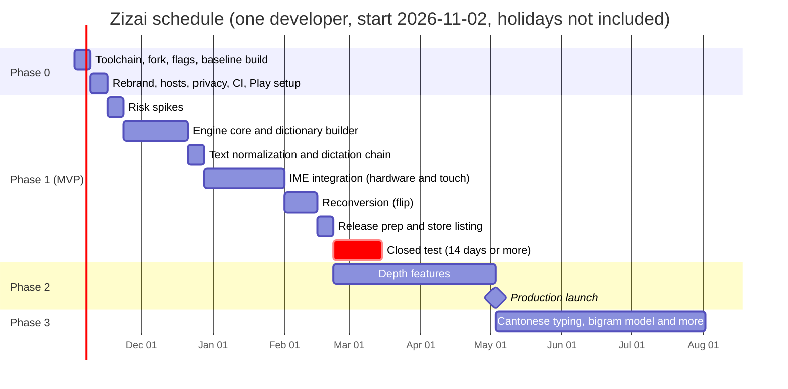

# 字在 Zizai — Implementation Plan

> The step-by-step plan for building what [ARCHITECTURE.md](ARCHITECTURE.md) describes, from an empty folder to a
> paid app in production on Google Play.

| | |
|---|---|
| **Status** | Draft 1 |
| **Date** | 2026-10-27 |
| **Companion to** | ARCHITECTURE.md, Draft 0.4 (all product decisions made) |
| **Assumes** | One developer, roughly full-time, working with Claude Code. Windows with Android Studio. Pixel 8 Pro + Bluetooth keyboard. Public GitHub fork. Personal Play developer account. Paid app. |
| **Where this file lives** | Next to ARCHITECTURE.md. Move both into `zizai/docs/` once the fork exists (P0-03). |

**How to read this:**

- §1 shows the schedule.
- §2–§5 list the work packages, phase by phase. Each package has an ID (P0-04, P1-11, …), a size, its
  dependencies, the files it touches, and a "done when" test.
- §6 covers routines that repeat: upstream syncs, definition of done, deadlines.
- §7 separates what only you can do from what Claude Code can implement.

**Sizes:** **S** is about a day; **M** is 2–4 days; **L** is 1–2 weeks. They're rough; re-plan after the
Phase 1 spikes.

---

## 1. Schedule



| Milestone | Target date | Exit criteria |
|---|---|---|
| **M0 Foundation** | 2026-11-15 | A signed AAB on the internal track, built by CI, installs as 字在 with the v1 features switched off |
| **M1 Spikes done** | 2026-11-22 | The four risky assumptions (§3.1) confirmed or the design adjusted |
| **M2 Engine ready** | 2026-12-20 | `:lib:han-engine` passes golden tests on the JVM; `han-core.bin` builds from pinned sources |
| **M3 Typing end to end** | 2027-01-31 | Pinyin from the Bluetooth keyboard and the touch keyboard works in Chrome, Gmail, Google Docs and Telegram |
| **M4 MVP: closed test starts** | 2027-02-22 | Phase 1 exit criteria (§3.7); at least 12 testers opted in |
| **M5 Closed test passed** | 2027-03-08 at the earliest | 14 consecutive days with at least 12 testers |
| **M6 Production launch** | 2027-05-03 | Phase 2 exit criteria (§4) |
| **M7 Cantonese typing** | 2027-08 | Jyutping shipped |

Christmas, New Year and other holidays aren't in the dates; add your own. The plan starts the closed test
after Lunar New Year (2027-02-06), because testers in Chinese communities are less available that week.

**Critical path:** toolchain → fork → flags → engine core → IME integration → reconversion → store listing →
closed test → production access. The text-normalization work and Phase 2 features can slide; that path
can't.

---

## 2. Phase 0 — Fork and foundation (2 weeks)

### P0-01 Pre-upload gate · S · you · parallel with everything in Phase 0

- **Do:** trademark searches for 字在 / Zizai in Taiwan (TIPO), Hong Kong (IPD) and mainland China (CNIPA);
  register `zizai.io`; decide which address EU users see for trader status. Consider registering the
  trademark, since the code is public.
- **Done when:** results recorded in ARCHITECTURE.md §12. **Must finish before P0-10**, because the first
  Play upload makes `io.zizai.keyboard` permanent.

### P0-02 Toolchain · S

- **Do:** install Android Studio (current stable) with SDK Platform 36, build-tools 36.0.0, NDK
  29.0.14206865, CMake 4.1.2 and JDK 17. Install Python 3 from python.org and turn off the Microsoft Store
  `python` alias in Windows settings; the sherpa-onnx fetch script needs it. Git for Windows (Git Bash) is
  already installed.
- **Done when:** Android Studio's SDK Manager shows those versions installed, and `python --version`
  prints 3.x in Git Bash.

### P0-03 Fork, clone, docs · S

- **Do:** fork `DevEmperor/DictateKeyboard` with GitHub's Fork button and name it `zizai`. Clone it into
  this folder and add the `upstream` remote (ARCHITECTURE.md §7.1 has the commands). Move ARCHITECTURE.md
  and this file into `zizai/docs/`.
- **Done when:** `main` contains `docs/ARCHITECTURE.md` and `docs/IMPLEMENTATION_PLAN.md`, and
  `git remote -v` lists `origin` and `upstream`.

### P0-04 Feature flags · M · after P0-03

This comes first among the code changes, because upstream's build fails without the Bergamot translation
library.

- **Do:**
  - Add `zizai.properties` (version code and name, plus `ZIZAI_CLOUD`, `ZIZAI_FLOATING_BUTTON`,
    `ZIZAI_TRANSLATE`, `ZIZAI_GIF`, all `false`). Read it in `app/build.gradle.kts` and expose the flags
    as `BuildConfig` fields.
  - With `ZIZAI_TRANSLATE=false`: skip `verifyBergamotLib` and exclude `**/libdictate_bergamot.so` from
    packaging.
  - Add `app/src/release/AndroidManifest.xml` that removes, with `tools:node="remove"`:
    `DictateAccessibilityService`, the `FOREGROUND_SERVICE_MICROPHONE` permission,
    `TranslationEngineService`, `DictateWearService`, `WearTetherService`, and the
    `com.android.vending.BILLING` permission. A build-type manifest overrides upstream's main manifest
    without editing it.
  - Add a `ZizaiFlags` object and hide the matching UI: the `cloud` provider preset (setup wizard and
    providers screen), the floating-button settings entry and its onboarding nudge
    (`maybePromptFloatingButton`), and the Translate and GIF quick actions (`KeyCode.TRANSLATE`,
    `KeyCode.IME_UI_MODE_GIF` in `QuickAction.kt`). Keep FlorisBoard's own floating *keyboard* mode
    (`TOGGLE_FLOATING_WINDOW`); it's unrelated.
- **Files:** new `zizai.properties`, `app/src/release/AndroidManifest.xml`, `ZizaiFlags.kt`. One-line
  hooks in `app/build.gradle.kts`, `SetupScreen.kt`, the providers screen, `QuickAction.kt` and
  `FlorisImeService.kt`.
- **Done when:** a release build's merged manifest has no accessibility service, billing permission or
  translation service; none of the hidden entry points appear in the app.

### P0-05 Baseline build and smoke test · M · after P0-04

In Git Bash at the repo root, fetch the sherpa-onnx libraries, then build and run the unit tests:

```bash
bash tools/fetch-sherpa-onnx.sh
```

```bash
./gradlew assembleDebug test
```

- **Then:** install the debug APK on the Pixel 8 Pro, turn the keyboard on, and dictate once using the
  on-device SenseVoice model.
- **Done when:** the debug app runs on the Pixel and a dictation lands in a text field. Any unit-test
  failures that already exist upstream are written down, so later regressions are clear.

### P0-06 Rebrand · M · after P0-05

- **Do:**
  - `applicationId` → `io.zizai.keyboard` in `app/build.gradle.kts`. Also change `wear/build.gradle.kts`,
    which hard-codes `net.devemperor.dictate`, so a future Wear release can pair with the phone app.
  - App name through resource overlays rather than upstream's 40+ translated files:
    - Add `app/src/release/res/values/strings_zizai.xml` with `floris_app_name` = Zizai, and
      `app/src/release/res/values-zh/strings_zizai.xml` with 字在.
    - Update upstream's debug and beta overlays ("Dictate Debug" → "字在 Debug").
    - Point the five code references to `R.string.app_name` at `floris_app_name`.
  - New launcher and adaptive icons; About screen attribution ("字在 (Zizai) is based on Dictate Keyboard
    by DevEmperor, itself a fork of FlorisBoard"); `NOTICE` additions; issue tracker, website and privacy
    links; the "What's new" tour links.
  - Add the Apache-2.0 §4(b) "Modified by Zizai contributors" header line to every upstream file touched
    so far.
- **Done when:** every name a user can see says 字在 (Chinese locales) or Zizai (all others), and nothing
  links to upstream's site or issue tracker.

### P0-07 Download hosts · M

- **Do:** put the release-asset base URL in one constant. Mirror the assets v1 uses (the Whisper and
  SenseVoice models offered, glide/bigram/trigram dictionaries, the Pinyin pack) to `zizai` release tags,
  each with its license and attribution files, and keep upstream's size and SHA-256 checks.
  Development can keep upstream's URLs until the closed test.
- **Done when:** a network log of a full setup shows no requests to `DevEmperor/DictateKeyboard` release
  URLs or `api.dictatekeyboard.com`.

### P0-08 Privacy policy and disclosure · M

- **Do:** rewrite the privacy policy for Zizai (no Dictate Cloud, paid app, AI-output reports, opt-in
  proofreading) and publish it with GitHub Pages from the repo. Link it from the app. Reword the
  prominent-disclosure screen shown before the first cloud transcription.
- **Done when:** the policy URL is live and linked in the app.

### P0-09 Continuous integration · M

- **Do:** add `.github/workflows/ci.yml` (Ubuntu, JDK 17, Android SDK, Gradle cache, sherpa-onnx fetch,
  `assembleDebug test lint`) and `release.yml`, which runs on tags `zizai-v*`:
  - Build the signed AAB.
  - Run the 16 KB checks: `zipalign -c -P 16 -v 4`, plus ELF `LOAD` alignment of every arm64 `.so`.
  - Upload to the internal track with Gradle Play Publisher.
  - Signing key and Play service-account JSON live in GitHub Actions secrets, never in the repository.
- **Done when:** CI is green on `main`, and a test tag produces a signed AAB that passes the 16 KB checks.

### P0-10 Play Console setup and first internal release · M · you and Claude Code · after P0-01

- **Do (you):**
  1. Finish the personal developer account's identity verification and set up a payments merchant
     profile.
  2. Create the app "字在 Zizai" and **set it as paid, with a price, before any release.** An app that has
     been offered free can never become paid.
  3. Generate the upload key, keep two offline backups, and enroll in Play App Signing.
  4. Add yourself and a second account as internal testers.
- **Do (Claude Code):** wire the upload key into the release signing config through `keystore.properties`
  (ignored by git) and the CI secrets.
- **Done when:** an internal tester installs 字在 from Google Play.

**Phase 0 exit:** M0 in §1.

---

## 3. Phase 1 — MVP to closed test (about 14 weeks)

#### Progress (2026-10-29)

| Task | State | Notes |
|---|---|---|
| S1–S3 | Done | Results below |
| P1-01 – P1-07 | Done | Engine, data and session; JVM tests, about 130 golden inputs |
| P1-08 | Done | han-ext-modern.bin (6.9 MB, CC BY-SA) published on the `han-packs-v2` release (v2: newer words ranked up); 中文 settings switch downloads or deletes it; retry tags (`han-packs-v1-r2`) publish to the same release |
| P1-09, P1-10 | Done | OpenCC 1.1.9 test cases pass; dictation clean-up hooked into `DictateController.sink` |
| P1-11 – P1-15 | Done | Checked on the Pixel 8 Pro (Keep, search fields) |
| P1-16 | Done | Smartbar candidates for the touch keyboard; no expanded grid sheet yet |
| P1-17 | Done | 中文 settings screen, Ctrl+/ cheat sheet, first-use sheet |
| P1-18 | Done, minus `replaceText` on API 34+ | Context reading and ranking, read-back restore, the touch 改 chip |
| P1-19 | Blocked on you | Needs a Cloudflare account for the report Worker |
| P2-02 | Done | Learning (picks rise after two, 造词 phrases at once, also by initials), Ctrl+Delete blocklist, no learning in incognito, password or no-learning fields, `files/zizai/han_user.tsv` in the backup rules; 我的词 screen with delete, unblock and JSON export/import |
| P2-03 | Mostly done | Fuzzy pairs (all 11), double Pinyin 小鹤, 自然码 and 微软 with golden tests, both in 中文 settings. Not yet: Sogou, Ziguang, Pinyin Jiajia schemes |
| P2-01 | Mostly done | Ctrl+F2 flips the 2–4-character word before the cursor (main readings first), falling back to one character. Not yet: flipping a selection |
| P2-10 | Done | han-yue.bin (Unihan kCantonese plus kSMSZD2003Readings with rime-cantonese since P3-01: 737 Jyutping syllables, 32k characters; written-Cantonese characters ranked up via kUnihanCore2020). The flip uses it when the dictation language is Cantonese |
| P3-01 | Mostly done | 中文 settings > Typing language: Cantonese types Jyutping (initials, apostrophes, tone filter 1–6, optional lazy sounds) against han-yue.bin, now with rime-cantonese's reading shares, 112k words and essay frequencies, bundled rather than a separate pack. Learned words go to `han_user_yue.tsv`. Not yet: a Hong Kong subtype that picks Cantonese and Traditional output by itself |
| P2-05 | Mostly done | The touch strip leads with a tone chip (cycles like Tab) and pages through every candidate 40 at a time (◂ / 更多 ▸). Not yet: a grid sheet with tone tabs (needs a hook in the keyboard layout) |
| P2-09 | Draft done, needs your review | zh-TW (s2twp) and zh-HK (s2hk) UI strings machine-drafted from zh-CN by `han-dict-builder --strings`, branded 字在; screenshots and listings still to do |
| P2-07 | Done (Chinese hot words) | The user's top 30 Chinese words and phrases join upstream's custom-word glossary for Chinese and Cantonese dictation. Not yet: Qwen glossary context (with P2-06) and the evaluation set |
| P2-06 | Done, not tried live | QwenAsrClient (chat/completions with a WAV data URL, glossary as system context, asr_options language and ITN), two presets (Singapore, Beijing) with an editable workspace URL; MockWebServer tests. A real Mandarin round-trip needs your Model Studio account |
| P2-08 | Done, not tried live | Off by default, no default model: the switch is disabled until a model is picked from the user's own chat providers. Proofreading.parse validates the JSON contract (code-point spans, original must match, Han-only suggestions, no overlaps, at most 20); suspects are kept with the dictated span, F8 / Shift+F8 open the flip with the model's suggestions first after a read-back; the pill shows the count. Report action waits for P1-19 |
| P2-04 | Mostly done | Compact preset (; and ' pick 2nd and 3rd, , and . page, holding Backspace cancels), "press the key to bind" for flip, push-to-talk and next suspect, per-app bypass list. Waiting on testers: device presets from captured key codes |
| P1-20 | Partly | Exceptions reset the session; `zizai.onKey` trace sections and a `ZizaiLatency` log. JVM: first page 0.08–0.14 ms. Debug build on the Pixel: p50 ≈ 8 ms, p95 ≈ 14–20 ms, which is debuggable ART; the release-optimized `benchmark` build still has to be measured (it must be enabled as a keyboard) |
| P1-21, P1-22 | Yours | Store listing and closed test |

Still open: the 2 ms budget measured on the phone
(P1-20), and the grid sheet for touch (P1-16).

### 3.1 Risk spikes (week 1)

Each spike is a throwaway branch that answers one question before real code depends on it. Record the
results in ARCHITECTURE.md.

| ID | Question | Method | Pass |
|---|---|---|---|
| **S1** | Can the IME take hardware letters and show a caret-anchored panel without resizing the app? (ADR-5) | Intercept letters in `FlorisImeService.onKeyDown`; show a dummy Compose panel positioned from `CursorAnchorInfo`; Pixel 8 Pro + Bluetooth keyboard in Chrome, Gmail, Google Docs, Telegram, WhatsApp | Correct position in at least 4 of 5 apps; bottom-dock fallback works in the rest; touch on the panel works |
| **S2** | Does the microphone work while the IME window is shown but empty? (§3.1 of the architecture) | Start recording from a hotkey in hardware mode, then with the window fully hidden | Recording works when shown; failure when hidden is understood |
| **S3** | Can committed text be reconverted in place? | `setComposingRegion` + `setComposingText` on existing text in Chrome/WebView, Gmail, a Compose `TextField` and an `EditText`; `replaceText` on API 34+; read the text back | Works in at least 3 of 4 editors; a read-back mismatch is detectable |
| **S4** | Can closed testers of a paid app install it for free? | Create a promo code in Play Console and redeem it with the second test account | Code redeems before production; otherwise fall back to refunds |

If S1 or S2 fails, stop and revise ADR-5 before starting P1-10.

#### S1 result: passed (2026-10-28)

Spike code: branch `spike/s1-hardware-panel`. Tested on the Pixel 8 Pro (Android 16) with key events
injected by `adb shell input keyevent`, which reach the IME exactly like a hardware keyboard's.

| App | Composing text | Panel at caret | Notes |
|---|---|---|---|
| Google Keep (note body) | ✓ | ✓ | Follows the caret onto a new line |
| Chrome (google.com search box) | ✓ | ✓ | The page sees the Pinyin as text and suggests on it; panel-only preedit mode will matter here |
| Google Messages (compose field at the bottom) | ✓ | ✓ | Panel correctly flips above the caret |
| Settings search | ✓ | ✓ | |

Not tested yet: Google Docs, WhatsApp and Telegram (not installed), and a real Bluetooth keyboard.

What the real implementation must take from it:

- **Cursor geometry is good enough.** All four apps reported `CursorAnchorInfo.insertionMarker*`; the
  matrix-to-screen mapping put the panel right under the caret.
- **Upstream's composing reconciliation must be suspended** while our session owns the preedit
  (ADR-2 confirmed): with it running, every `setComposingText` was committed and the text duplicated. The
  spike skipped `editorInstance.handleSelectionUpdate` in `onUpdateSelection` while active.
- **Hide upstream's keyboard with `INVISIBLE`, not `GONE`.** The IME window wraps its content, so `GONE`
  shrinks it to a 108 px strip and a caret-anchored panel falls outside it.
- **The app keeps its full height** with `contentTopInsets = visibleTopInsets = window height` and a
  touchable region of just the panel.
- **Touching the field returns to the on-screen keyboard** through `onViewClicked`.
- **Clearing a composition must empty it first** (`setComposingText("")`, then `finishComposingText`);
  finishing a one-letter composition commits that letter.
- **adb key injection works as a test harness** for hardware typing, so P1-12 and P1-14 can have
  scripted on-device tests.

#### S2 result: confirmed (2026-10-28)

Same branch; Ctrl+Shift+Space called upstream's `DictateController.onMicClick`. Android doesn't refuse the
microphone to an app it considers in the background; it records silence. `dumpsys audio` shows that per
recording, and `cmd appops get <package> RECORD_AUDIO` shows rejections.

| Keyboard window | Recording | AppOps |
|---|---|---|
| Shown, keyboard view `INVISIBLE` (hardware mode) | `silenced:false` | Running in the foreground state |
| Hidden (after Back) | `silenced:true` | Rejected |

So ADR-5 stands: **in hardware mode the IME window must stay shown** whenever dictation can start, and
P1-13 must keep it shown (with an invisible keyboard view) rather than letting Android hide it. Dictation
hotkeys pressed while the window is hidden must first show it (`requestShowSelf`) and only start recording
once it is visible.

#### S3 result: passed (2026-10-28)

Same branch; F2 flipped the character before the cursor through dummy homophones (是 → 事 → 时 → 市) with
`setComposingRegion(pos-1, pos)` + `setComposingText(next, 1)`, reading the result back with
`getTextBeforeCursor`. Enter confirmed with `finishComposingText()`.

| App | End of text | Middle of text | Readback |
|---|---|---|---|
| Settings search | ✓ | n/a | matches |
| Messages | ✓ | ✓ | matches |
| Chrome (address bar) | ✓ | ✓ | matches |
| Keep | ✓ | ✓ | matches |

The position comes from `getExtractedText` (`startOffset + selectionStart`). P1-18 keeps the readback
check and falls back to delete-and-commit when it fails or `getExtractedText` returns null, but no tested
app needed it. Lesson from S1: cancel a composition with `setComposingText("", 1)` before
`finishComposingText()`, or the last letter is committed.

### 3.2 Engine and data (weeks 2–5)

#### P1-01 Module skeletons · S

- **Do:** add `:lib:han-engine` and `:lib:zh-text` (Kotlin/JVM with kotest and kover, like upstream's
  `:lib:kotlin`) and `:tools:han-dict-builder` (a Kotlin/JVM application). Include them in
  `settings.gradle.kts`.
- **Done when:** `./gradlew :lib:han-engine:test` runs an empty test suite.

#### P1-02 Readings and syllables · M · after P1-01

- **Do:** the ≈410 toneless Mandarin syllables and their tones; Pinyin spellings (including `v` for ü);
  `Reading` and `Phonology` types that allow Cantonese later; tone-mark rendering (shi4 → shì).
- **Done when:** every syllable round-trips spelling → id → spelling, and tone marks render correctly for
  all of them.

#### P1-03 Parser and syllable lattice · L · after P1-02

- **Do:** quanpin, jianpin and mixed input, apostrophes, an incomplete last syllable, and a scored DAG of
  segmentations (ARCHITECTURE.md §6.2).
- **Done when:** golden cases pass (`xian`, `xi'an`, `fangan`, `zg`, `zhongg`, `lv`, `nve`), and property
  tests show that any valid syllable sequence parses back to itself.

#### P1-04 Dictionary builder · L · after P1-02

- **Do:**
  - `sources.lock` pins each source by URL, SHA-256 and license: Unihan (`Unihan.zip` from unicode.org),
    AOSP PinyinIME `rawdict_utf16_65105_freq.txt` (UTF-16, so decode it as such), the OpenCC
    dictionaries, and optionally jieba `dict.txt`.
  - A license allow-list gate that fails the build on anything not allowed (no GPL, ever).
  - Normalization: readings, ü, tones, variants, tiers from `kTGH`, Big5 levels from `kBigFive`, GB2312
    from `kGB0`. Compose readings for words that lack one.
  - Write `han-core.bin` (the section layout in ARCHITECTURE.md §6.8) plus `manifest.json`, into
    `app/src/main/assets/han/`. Add `androidResources { noCompress += "bin" }` so the file can be
    memory-mapped (hook in `app/build.gradle.kts`).
- **Done when:** the same sources produce byte-identical output; the invariant tests pass (every one of
  the 8,105 General Standard characters is reachable from each of its readings; no GPL input).

#### P1-05 Lexicon reader · M · after P1-04

- **Do:** a memory-mapped reader with no per-lookup allocation. It runs on the JVM in tests and on
  Android from an `AssetFileDescriptor` mapped through `FileChannel.map`.
- **Done when:** lookups agree with the builder's own index on the full data, and 10,000 random lookups
  stay well inside the keystroke budget on the Pixel 8 Pro.

#### P1-06 Candidates and ranking · L · after P1-03, P1-05

- **Do:** assemble candidates in order: user phrases (stub for now), best whole-input path (word-unigram
  Viterbi), longest-prefix words, then all homophones of the first syllable. Lazy paging; filters for
  tone, tier, script and renderability (renderability is a callback that Android fills in with
  `Paint.hasGlyph`); 以词定字; partial commit.
- **Done when:** golden top-N tests pass for about 200 common inputs, and paging through every homophone
  of `yi` never materializes the whole list.

#### P1-07 HanSession · L · after P1-06

- **Do:** the state machine (Idle, Composing, Expanded, Reconverting); the Appendix A full-keyboard keys;
  Simplified punctuation; `KeyResult` and `EditorEdit` outputs; immutable `HanUiState` snapshots.
- **Done when:** scripted key sequences produce the expected edits against a fake editor, and `onKey`
  stays under 2 ms at the 95th percentile on the Pixel 8 Pro.

#### P1-08 Extended Pinyin pack · M · should-have

- **Do:** rebuild upstream's CC BY-SA Pinyin data (`tools/pinyin-dict/generate.py`, which needs Python)
  into our format as `han-ext-modern.bin`. Download it through a `HanPackManager` that follows upstream's
  `PinyinPackManager` pattern (size and SHA-256 checks, atomic install), with attribution files.
- **Done when:** installing the pack measurably improves the golden top-N results, and deleting it falls
  back to the core lexicon cleanly.

### 3.3 Text normalization and dictation chain (week 6)

#### P1-09 Text normalization (`:lib:zh-text`) · M · after P1-04

- **Do:** an OpenCC-compatible converter (the builder compiles OpenCC's dictionaries into
  `zh-convert.bin`; runtime uses maximum forward matching for `s2t`, `s2tw`, `s2twp`, `s2hk` and `t2s`);
  punctuation normalization by locale; whitespace cleanup between Han characters; optional CJK–Latin
  spacing.
- **Done when:** the converter passes OpenCC's own test cases (Apache-2.0), and punctuation rules pass
  their tests.

#### P1-10 Transcript post-processing · M · after P1-09

- **Do:** a `TranscriptPostProcessingSink` that wraps `DictationSink` (one hook where `DictateController`
  creates the sink). The chain runs whitespace cleanup, then punctuation, then OpenCC to the chosen output
  script, and upstream's find-and-replace rules still apply. Realtime previews get a light per-delta
  conversion plus a final pass. Make Mandarin (Simplified) the default dictation language.
- **Done when:** recorded transcript fixtures (mixed-script Whisper output, missing full-width
  punctuation) come out as clean Simplified text, and the Traditional settings produce Taiwan and Hong
  Kong forms.

### 3.4 IME integration (weeks 7–11)

#### P1-11 Service hooks · M · after S1

- **Do:** a `ZizaiHooks` object as the single entry point. One-line hooks in `FlorisImeService`:
  - `onKeyDown` and `onKeyUp` call our router first.
  - New overrides for `onUpdateCursorAnchorInfo` and `onUpdateEditorToolType` (API 34+).
  - Adjust `onEvaluateInputViewShown`; merge the panel and pill regions in `onComputeInsets`.
  - Forward `onUpdateSelection` to the session.
- **Done when:** every hook is a single `// ZIZAI-HOOK:` line, and upstream behaviour is unchanged when no
  Chinese subtype is active.

#### P1-12 Hardware key router · L · after P1-07, P1-11

- **Do:**
  - `KeyStroke` normalization through `getUnicodeChar(metaState)`, with the device profile from
    `InputDevice.hasKeys`.
  - The routing table in ARCHITECTURE.md §6.1, with key-down/key-up pairs always consumed together.
  - Shift tap, auto-repeat, and field-type rules (`TYPE_NULL`, password, `IME_FLAG_FORCE_ASCII`).
  - Global hotkeys: push-to-talk on held Right Ctrl, Ctrl+Shift+Space, Esc, Ctrl+Shift+F, Ctrl+., Ctrl+/.
- **Done when:** unit tests with synthetic `KeyEvent`s cover each routing rule, and on the Pixel no app
  ever sees a stuck modifier.

#### P1-13 Hardware mode and window · L · after P1-11

- **Do:** switch between touch and hardware mode (first printable hardware key; finger or stylus touch
  switches back). Keep the IME window shown but minimal in hardware mode, with a status pill (中/英, mic,
  recording). Insets must not resize the app; only the panel and pill are touchable. Reuse the inset logic
  of upstream's floating keyboard mode.
- **Done when:** typing on the Bluetooth keyboard never resizes the app, and dictation hotkeys work in
  hardware mode (confirmed by S2).

#### P1-14 Floating candidate panel · L · after P1-13

- **Do:** a Compose panel with a numbered horizontal page, highlight, page indicator and tone-filter label,
  plus an expanded grid with one row per tone. Use Snygg theme tokens and TalkBack announcements. Position
  it from `CursorAnchorInfo`: transform to screen coordinates, flip above the caret near the bottom, clamp
  to the screen, and dock at the bottom when there's no geometry.
- **Done when:** the panel sits under the caret in the S1 apps, follows the caret across lines, and
  matches the keyboard theme.

#### P1-15 Preedit rendering and editor hook · M · after P1-07

- **Do:** inline Pinyin preedit with `setComposingText` and a panel-only mode, with batch edits and a
  per-package compatibility list. Add the `EditorInstance` hook that suspends upstream's composing
  reconciliation while the session owns the preedit. Reset the session if the app drops the composition.
- **Done when:** in each S1 app the preedit underlines correctly, commits cleanly, and never duplicates
  text.

#### P1-16 Touch path · M · after P1-07

- **Do:**
  - Our own keyboard-extension asset `assets/ime/keyboard/io.zizai.localization/extension.json`, with a
    Simplified Pinyin subtype preset on provider id `io.zizai.han`.
  - Register that provider in `NlpManager`'s provider map as a no-op (hook).
  - `KeyboardManager` hooks: `onInputKeyUp` sends Pinyin keys to the session, and `commitCandidate` sends
    our candidates back to it. The session's pages are published to the Smartbar row.
- **Done when:** touch typing uses the same session as the Bluetooth keyboard: same candidates,
  segmentation and paging.

#### P1-17 Settings and onboarding · M

- **Do:**
  - A separate `ZizaiPrefs` store, so upstream's `AppPrefs` never conflicts.
  - A "中文 / Chinese" settings screen (route hook in `Routes.kt`) with: output script (简 by default),
    page size, orientation, hardware mode (Auto/Touch/Hardware), Shift-tap behaviour, punctuation width.
  - The first-hardware-keyboard onboarding card and the Ctrl+/ cheat sheet.
  - New strings go in `strings_zizai.xml` with zh-CN translations.
- **Done when:** each setting changes behaviour without a restart, and the cheat sheet matches the active
  keymap.

### 3.5 Reconversion (weeks 12–13)

#### P1-18 Flip v1 · L · after P1-15, S3

- **Do:**
  - The flip on the character before the cursor: F2 or Alt+Space. Repeat moves forward, Shift goes back,
    digits pick, Esc reverts, and Enter or any printable key confirms.
  - Context from `getSurroundingText` on API 31+, with a fallback below. Code-point indexing, so
    Extension B characters work.
  - Readings: the lexicon word around the cursor first, then per-character weights.
  - Live preview with `setComposingRegion` + `setComposingText`; `replaceText` on API 34+ where an editor
    needs it; read-back after each step.
  - A touch entry point: the 改 chip.
- **Done when:** in the S3 editors, flipping 在 after dictation reaches 再 in at most two presses with
  the right context, and a forced read-back mismatch restores the original text.

### 3.6 Release preparation (week 14)

#### P1-19 Report AI output · M

- **Do:** a Report action on reworded and voice-command results, with an optional note, sent to a small
  serverless endpoint (a new `report/` Cloudflare Worker, following the pattern of upstream's `cloud/`).
  The Worker stores reports or emails them to you, rate-limited.
- **Done when:** a report submitted on the Pixel arrives, and the Data safety draft lists it.

#### P1-20 Performance and stability gate · M

- **Do:** trace sections around the key path and panel rendering; measurements on the Pixel 8 Pro and a
  low-end emulator profile; baseline-profile entries for the hot paths. Any exception inside the session
  resets it and passes the key through.
- **Done when:** the latency budgets in ARCHITECTURE.md §6.10 hold on both, and a fault injected into the
  session never wedges the keyboard.

#### P1-21 Store listing and policy forms · M · you and Claude Code

- **Do:**
  - Listings: en-US and zh-CN, using the titles and short descriptions in ARCHITECTURE.md §8.4, plus the
    zh-TW and zh-HK copy. Write the full descriptions.
  - Art: Simplified-Chinese screenshots from the Pixel 8 Pro, a feature graphic and the icon.
  - Forms: Data safety (§8.3), content rating, target audience, app-access steps for reviewers (on-device
    SenseVoice needs no key), the `dataSync` foreground-service declaration, ads = none, trader status.
- **Done when:** Play Console shows no blocking issues for the closed track.

#### P1-22 Closed test · M, plus at least 14 calendar days

- **Do:** recruit 15–20 testers: Simplified-Chinese communities first, plus at least two keyboard-phone
  owners. Hand out promo codes (or refund purchases, if S4 failed). Open one feedback channel, such as
  GitHub Discussions. Check opt-in counts daily, because the 14-day clock restarts if it drops below 12.
- **Done when:** 14 consecutive days with at least 12 testers opted in.

### 3.7 Phase 1 exit criteria

- The closed test is running with at least 12 testers opted in.
- Every full-keyboard binding in ARCHITECTURE.md Appendix A works on the Pixel 8 Pro with the Bluetooth
  keyboard in Chrome, Gmail, Google Docs, Telegram and WhatsApp.
- Latency budgets met; no crashes in the key path during the first test week.
- All Play Console forms submitted.

---

## 4. Phase 2 — Depth, then production (about 10 weeks, overlapping the closed test)

| ID | Work package | Size | Depends on | Done when |
|---|---|---|---|---|
| P2-01 | Word and selection reconversion (Ctrl+F2; segmenting the surrounding text) | M | P1-18 | Two- to four-character words flip as units in the S3 editors |
| P2-02 | Learning and user dictionary: Room database `zizai_han_user`, counts and recency, 造词, Ctrl+Delete blocklist, no learning in incognito, password or no-learning fields, editor UI, JSON export/import, backup rules hook | L | P1-07 | Repeated selections rise in rank; nothing is learned in incognito; a backup restores the dictionary |
| P2-03 | Fuzzy Pinyin pairs and double-Pinyin schemes (Xiaohe, Microsoft, Ziranma, Sogou, Ziguang, Pinyin Jiajia) | M | P1-03 | Golden tests per scheme |
| P2-04 | Keymap editor ("press the key to bind"), compact-keyboard presets from testers' captured key codes, per-app bypass list | L | P1-12, closed-test feedback | Testers with keyboard phones confirm the compact preset |
| P2-05 | Touch candidate grid sheet with tone tabs and filters | M | P1-16 | All homophones reachable by touch |
| P2-06 | Qwen3-ASR-Flash: `QwenAsrClient` (new file in `:lib:dictate-core`) plus a one-line dispatch hook; Singapore and Beijing presets with editable workspace URLs; m4a if accepted, otherwise WAV with long-form segmentation; language and ITN options | M | — | MockWebServer tests (upstream's pattern) pass, and a real Mandarin dictation round-trips |
| P2-07 | Hot-word biasing from the user dictionary, within upstream's prompt token budget; glossary context for Qwen | S | P2-02 | Names from the dictionary transcribe correctly more often in the evaluation set |
| P2-08 | LLM homophone proofreading: opt-in, **no default model** (picker gates the switch); JSON contract and validation; suspect spans tied to the dictation span; F8 / Shift+F8 navigation; disclosure; Report action | L | P1-18, P1-19 | Suspects never change text without confirmation; invalid model output is dropped safely |
| P2-09 | Traditional polish: zh-TW UI strings (OpenCC `s2twp` draft plus your review), zh-HK wording where it differs, Traditional screenshots, zh-TW and zh-HK listings | M | P1-17 | No untranslated strings in zh-TW |
| P2-10 | Cantonese character readings (Unihan `kCantonese`) so the flip works on Cantonese dictation; update the Hong Kong listing's claim | M | P1-18 | Common Cantonese homophone errors flip to the right character |
| P2-11 | Production launch: apply for production access from the Dashboard (Google asks about the closed test), staged rollout at 10%, 50% and 100%, then watch Android vitals (crash rate under 1.09%, ANR rate under 0.47%) and the acquisition reports' search terms | M | P1-22 passed | 100% rollout with vitals under the thresholds |

**Phase 2 exit (M6):** production at 100%, vitals under thresholds, all P2 packages done or explicitly
deferred.

---

## 5. Phase 3 — Quality and reach (2027 Q2–Q3)

| ID | Work package | Size | Notes |
|---|---|---|---|
| P3-01 | **Cantonese typing (Jyutping)**: parser, lazy-sound fuzzy pairs, `han-ext-yue.bin` from rime-cantonese (CC BY 4.0, without the ODbL `jyut6ping3.maps`), a Hong Kong subtype with Traditional output by default, tone filter | L | Committed (decision 8) |
| P3-02 | Bigram language model with Viterbi or beam search, plus context ranking for reconversion | L | Needs a license-clean source of bigram counts |
| P3-03 | Streaming on-device Chinese recognition (sherpa-onnx Paraformer or Zipformer) | M | Evaluation first |
| P3-04 | Stroke-filter mode | M | Needs a stroke dataset with a usable license |
| P3-05 | librime backend spike | M | Only if sentence-level quality falls short |
| P3-06 | Zhuyin | M | Only if demand appears |
| P3-07 | Target API 37 | S | Expected Play deadline around 2027-08-31; usually arrives through an upstream sync |

---

## 6. Routines and rules

### 6.1 Upstream sync (every 1–2 weeks)

Fetch upstream, branch from `main`, and merge:

```bash
git -C zizai fetch upstream
```

```bash
git -C zizai switch -c sync/upstream-YYYY-MM-DD main
```

```bash
git -C zizai merge upstream/main
```

Then:

1. Resolve conflicts. They should only appear in the hook files (ARCHITECTURE.md Appendix B).
2. Run the unit tests and a smoke test on the Pixel.
3. **Compare the merged release manifest with the previous release's.** New permissions or
   foreground-service types need a Play declaration, or removal in `app/src/release/AndroidManifest.xml`.
4. Check new upstream features against the v1 flags, and check provider and model changes.
5. Regenerate the branding overlay, so new or changed upstream strings say Zizai, and commit it:
   `python tools/zizai/branding.py`.
6. Open a pull request, let CI pass, and merge.

### 6.2 Definition of done (every work package)

- New logic has unit tests, and the existing tests still pass.
- Upstream files are touched only through one-line `// ZIZAI-HOOK:` hooks, and each touched file carries
  the "Modified by Zizai contributors" header line.
- New strings live in `strings_zizai.xml` with zh-CN translations (zh-TW from Phase 2).
- No new lint warnings in the key path.
- User-facing changes were checked by hand on the Pixel 8 Pro with the Bluetooth keyboard.
- ARCHITECTURE.md is updated if a decision changed.

### 6.3 Dates to watch

| Date | What | Action |
|---|---|---|
| 2027-02-01 | Play blocks updates that don't support 16 KB pages | CI check from P0-09 |
| 2027-02-06 | Lunar New Year | Closed test starts after it |
| 2027-02-26 | OpenAI removes `whisper-1`, `gpt-4o-transcribe`, `gpt-4o-mini-transcribe` (per upstream's notes) | Arrives through upstream syncs |
| around 2027-08-31 | Likely target API 37 requirement | P3-07 |

### 6.4 Tracking

Turn each work-package ID into a GitHub issue, grouped into milestones M0–M7, so progress is visible in
the public repository.

---

## 7. Who does what

| Only you can do | Claude Code can do |
|---|---|
| Trademark searches and registration; buying `zizai.io` | All code, build scripts and tests in §2–§5 |
| GitHub fork under your account | The CI workflows, and the GitHub issues and milestones (once `gh` is signed in) |
| Play Console: identity verification, merchant profile, price, declarations, production application | Drafts of every Play Console form, listing text and the privacy policy |
| Holding the upload key and its backups | Wiring the key into local and CI signing without committing it |
| Recruiting closed testers and handing out promo codes | The tester instructions and feedback template |
| Reviewing zh-TW and zh-HK wording; approving screenshots and art | Generating screenshots on the Pixel 8 Pro and drafting translations |
| Testing on the Pixel 8 Pro with the Bluetooth keyboard | Instrumented tests and emulator runs for API 26–33 |
